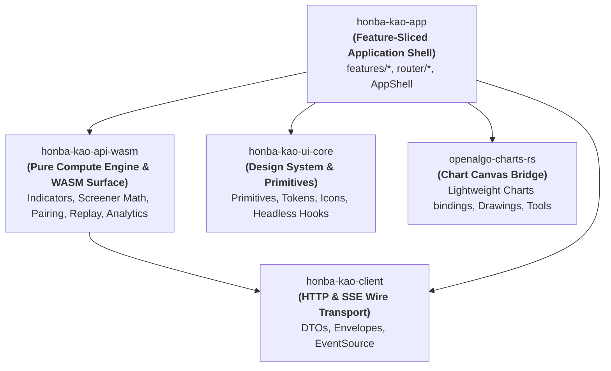

# Honba-Kao Architectural Health & Restructuring Plan (v2.0)

# Current Health Score: 6.7 / 10
  ├── Architectural Modularity: 5.5/10 (Compute crate schism: 320 KB sim in app while api-wasm is orphaned; dead composed modules)
  ├── Component Discipline:     6.5/10 (ui-core primitives extracted, components/ui deleted, but 22 raw HTML violations fail CI lint)
  ├── State & Reactivity:       6.5/10 (Screener & workbench god-stores decomposed; simulator.rs is a new 1,537-line god-store)
  ├── Runtime Safety & Leaks:   8.5/10 (Persistent AppShell via Leptos 0.7 <Outlet/>; listener cleanups fixed; doctests need repair)
  └── UI Performance & A11y:    7.0/10 (Virtualized screener table via use_virtual_rows; missing ARIA roles, focus traps & keyboard roving)

---

# 1. Progress Audit: What Landed Since Last Assessment

Over the recent refactoring cycles, significant architectural debt identified in v1.0 was addressed:

| Milestone / Area | Commit | Status | Verification & Outcome |
| :--- | :--- | :--- | :--- |
| **Consolidate Design System** | `10774ad`, `9987974` | **DONE** | Deleted `crates/honba-kao-app/src/components/ui/`. Moved `HfButton`, `HfPanel`, `HfCard`, `HfBadge`, `HfKpi`, `HfPageHeader`, `HfStatusCircle`, etc. to `honba-kao-ui-core`. Replaced local imports with `honba_kao_ui_core::*`. |
| **Persistent Router Shell** | `2edae63` | **DONE** | Refactored `router/app_routes.rs` into a nested layout using Leptos 0.7 `<ParentRoute view=AppShell>` and `<Outlet/>`. `AppChrome` stays mounted across route navigation. |
| **Event Listener Leak Fixes** | `2edae63` | **DONE** | Systematic `on_cleanup` de-registration added to `header_bar` scroll listener, `use_click_outside`, `use_escape_key`, `use_media_query`, `use_tick_stream`, and chart order-click events. |
| **God-Store Decomposition (Screener & Workbench)** | `25726cb` | **DONE** | Split `stores/screener.rs` (2,635 lines) into `columns.rs` (registry), `filter_engine.rs` (pure predicates/sort/CSV), and `screener_store.rs` (reactive state). Split `stores/workbench.rs` (1,627 lines) into `layout_store.rs`, `order_draft_store.rs`, `book_store.rs`, and coordinator `workbench_store.rs`. |
| **Table Virtualization** | `0faa736` | **DONE** | Virtualized `screener_table.rs` using `use_virtual_rows` hook in `honba-kao-ui-core`. Body renders top/bottom spacer `<tr>` elements around a clamped viewport slice with 6-row overscan. |
| **Chart Crate Extraction** | `4c04d42`, `b36f4e1` | **DONE** | Factored out `crates/openalgo-charts-rs` into an independent workspace crate (Apache-2.0) targeted for crates.io publication. |
| **Design System CI Guardrail** | `d8bfd69` | **PARTIAL** | Added `make lint-design-system` in `Makefile`. Prohibits raw `<button>` and `<input>` tags under `honba-kao-app/src/{components,pages}`. Currently catching 22 legacy violation sites. |

---

# 2. Critical Architectural Anti-Patterns & Diagnoses (Current Reality)

Despite the substantial progress, a closer critical inspection of the workspace reveals several major anti-patterns and structural splits that compromise maintainability, testability, and performance.

```
                              CURRENT CRATE DISCONNECT
  
   honba-kokoro / honba-ya / honba-me / honba-nou (Backend Core & Market Libs)
         ▲                                   ▲
         │                                   │
   honba-kao-client                    honba-kao-api-wasm (ORPHANED)
  (Typed HTTP & SSE)                 (67 tests passing, but UNUSED
         ▲                            by honba-kao-app! Only exposes
         │                            stringified JSON wasm-bindgen)
         │
         │                            honba-kao-app (MONOLITHIC APP)
         ├──────────────────────────► ├── src/sim/ (320+ KB pure compute duplicated)
         │                            ├── stores/simulator.rs (1,537-line god-store)
         ▼                            └── 22 raw HTML tag violations
   honba-kao-ui-core
   (Primitives + 4 Dead Composed Modules + 22 broken doctests)
```

## 2.1 The Compute Crate Schism: Orphaned `api-wasm` vs 320 KB App `sim/`
* **The Diagnosis**: `crates/honba-kao-api-wasm` was created to serve as the unified in-browser WASM compute engine (screener predicate evaluation, technical indicator series, and journal replay). It has 67 passing unit tests and 5 golden conformance test suites (`indicator_conformance.rs`, `ohlc_conformance.rs`, `render_conformance.rs`, `replay_conformance.rs`, `screener_conformance.rs`).
* **The Reality**: `honba-kao-app/Cargo.toml` **does not depend on `honba-kao-api-wasm`**.
* **The Bloat**: Instead of leveraging `honba-kao-api-wasm`, `honba-kao-app/src/sim/` has accumulated over **320 KB** of heavy computational logic:
  - `analytics.rs` (60 KB): Drawdown calculations, Sharpe/Sortino ratios, monthly return heatmaps, benchmark tracking.
  - `pairing.rs` (39 KB): FIFO/LIFO fill pairing, round-trip trip extraction, scale-in/scale-out leg merging.
  - `chart_data.rs` (27 KB) & `chart_series.rs` (22 KB): Candle formatting, indicator overlay projections.
  - `controls.rs` (25 KB) & `run.rs` (22 KB): Execution options, polling state machine, validation rules.
  - `engine/` (`controller.rs`, `evaluator.rs`, `indicators.rs`): Duplicate indicator evaluation.
* **The Architectural Flaw**: `honba-kao-api-wasm` was designed with stringified JSON C-ABI boundaries (`scan_predicate_json`, `replay_journal_json`) aimed at JavaScript clients (such as `honba-fe`). Calling those from Rust/Leptos would force double serde serialization. The compute core should be an idiomatic, typed Rust library (`rlib`) consumed directly by `honba-kao-app`, with `wasm-bindgen` JS bindings as an optional exterior facade.

## 2.2 The New God-Store: `stores/simulator.rs` (1,537 lines)
* **The Diagnosis**: While `screener` and `workbench` stores were successfully decomposed, `stores/simulator.rs` has grown into an unruly 1,537-line monolithic store.
* **Responsibilities Conflated in One Struct**:
  1. *Remote Polling & Lifecycle*: `submit_run`, `poll_loop`, `abort_run`, REST error handling.
  2. *Replay Transport & Engine*: Play/pause cadence timer, single-step candle progression, fast-forward instant execution, speed multiplier (`1x`–`50x`).
  3. *Chart Data & Marker Snapping*: Projecting bar slices and trade marker annotations onto chart datasets.
  4. *Local Persistence*: Serializing active strategy, universe, timeframe, and dates to `localStorage`.
  5. *Strategy Graph Compilation*: Manifest synthesis, content hashing, and validation diagnostics.
  6. *Confluence & Analytics Aggregation*: Computing live P&L, win-rate, profit factor, and active signal confluence.
* **Consequence**: Tight coupling makes unit testing UI interactions impossible without mocking entire simulator network runs and replay clocks.

## 2.3 Zombie Modules & Broken Doctests in `honba-kao-ui-core`
* **Orphaned Composed Modules**: `crates/honba-kao-ui-core/src/composed/` contains:
  - `chart_toolbar.rs` (95 lines)
  - `filter_bar.rs` (42 lines)
  - `header_bar.rs` (68 lines)
  - `sidebar.rs` (62 lines)
  None of these are imported or used anywhere in `honba-kao-app` (which maintains its own domain versions in `components/common/` and `components/workbench/`). They represent dead code and confuse crate consumers.
* **22 Broken Doctests**: Running `cargo test --workspace` fails because doctests in `honba-kao-ui-core` (`primitive/button.rs`, `primitive/input.rs`, `trading/pl_number.rs`, `icons/outline.rs`, `hooks/mod.rs`) attempt to compile raw Leptos snippets without importing `leptos::prelude::*` or declaring `no_run`.

## 2.4 Design System Boundary Violations (The 22 Unmigrated Sites)
* `make lint-design-system` reliably catches 22 raw `<button>` and `<input>` tags scattered across:
  - `components/screener/filters_modal.rs` (Close icon button, reset, apply)
  - `components/screener/open_screen_modal.rs` (Search clear, dismiss)
  - `components/screener/column_modal.rs` (Reset defaults, apply, dismiss)
  - `components/screener/drawers.rs` (Search clear)
  - `components/workbench/order_modal.rs` & `order_ticket.rs` (Side toggle buttons, close)
  - `components/workbench/pane_chart.rs` & `toolbar.rs` (Custom interval apply, status dismiss)
  - `components/common/nav_rail.rs` (Menu item triggers)
  - `components/auth/` (`login_page.rs`, `register_page.rs`, `reset_password_page.rs`, `setup_page.rs`)
* **Root Cause**: Missing dedicated primitives in `ui-core` for:
  - `HfSegmentedControl` / `HfToggleGroup` (for buy/sell side selectors and interval tabs)
  - `HfClearButton` / `HfInlineAction` (for search input clearing)
  - `HfModal` standardized close triggers

## 2.5 Technical-Layer vs Feature-Sliced Architecture (FSA)
* `honba-kao-app/src` is still organized by technical layers:
  `components/`, `pages/`, `stores/`, `sim/`, `types/`, `data/`.
* Code for a single feature is scattered across 5 disconnected directories:
  - **Screener**: `components/screener/*`, `pages/screener_page.rs`, `stores/screener_store.rs`, `stores/columns.rs`, `stores/filter_engine.rs`, `data/instruments.rs`.
  - **Simulator**: `components/simulator/*`, `pages/simulator_page.rs`, `stores/simulator.rs`, `src/sim/*`.
  - **Workbench**: `components/workbench/*`, `pages/workbench_page.rs`, `stores/workbench_store.rs`, `stores/layout_store.rs`, `stores/order_draft_store.rs`, `stores/book_store.rs`.
* This separation increases cognitive overhead and encourages cross-feature entanglement.

## 2.6 Parity Gap with Reference Frontend (`honba-fe`)
* As outlined in `docs/simulator-design-20-Oct.md`, `honba-kao`'s simulator UX lags behind `honba-fe`:
  - **Command Bar**: Bulky `<HfPageHeader>` and floating replay controls vs `honba-fe`'s fixed 56px 3-zone Command Bar (Left: selectors, Center: replay cluster, Right: live PnL & telemetry).
  - **Parameters Drawer**: Parameters are non-editable in the view vs `honba-fe`'s collapsible 360px sidebar for capital, fill model, slippage, and commission.
  - **Institutional Dock**: 8 fragmented text tabs vs 6 consolidated tabs with dynamic count badges, CSV export, and sandbox reset.
  - **Overview**: Monthly heatmap exiled to a separate tab vs side-by-side split grid with Equity Curve.

---

# 3. Target Crate Architecture & Clean Boundaries



### Crate Contract & Permitted Contents

| Crate | Permitted Contents | Forbidden Contents |
| :--- | :--- | :--- |
| **`honba-kao-ui-core`** | Reusable, headless/styled UI primitives (`HfButton`, `HfInput`, `HfSelect`, `HfCard`, `HfModal`, `HfBadge`, `HfSegmentedControl`, `HfDataGrid`), icons, CSS token mapping, reactive headless hooks (`use_virtual_rows`, `use_click_outside`, `use_escape_key`). | Domain models (instruments, tickets, orders, trades, NSE/BSE). No app business logic. No orphaned composed screens. |
| **`honba-kao-api-wasm`** | Numerical analytics, Sharpe/Sortino/drawdown math, strategy manifest compilation, FIFO/LIFO trade pairing, indicator pipelines, screener predicate evaluation. Exposes **typed Rust APIs** for internal crates, plus optional `wasm-bindgen` JS wrappers for external frontends. | DOM access, Leptos UI components, HTML rendering, UI store signals. |
| **`honba-kao-client`** | Type definitions, HTTP REST client, Server-Sent Events (`web_sys::EventSource`), envelope deserialization, wire models. | UI state, chart widgets, computational simulations. |
| **`openalgo-charts-rs`** | Low-level JS interop with OpenAlgo/TradingView Lightweight Charts, chart instances, drawing tool APIs, indicator overlays. | Leptos pages, application stores, network transport. |
| **`honba-kao-app`** | Feature-sliced application code (`features/*`), persistent `AppShell`, routing, reactive coordinator stores, theme provider. | Raw unstyled `<button>`/`<input>` tags, duplicate UI primitives, heavy offline computational math. |

---

# 4. Feature-Sliced Architecture (FSA) Structure for `honba-kao-app`

Refactor `honba-kao-app/src/` from technical-layer grouping into domain-sliced modules:

```text
crates/honba-kao-app/src/
├── app.rs                      # Root provider stack (Theme, Auth, QueryClient)
├── lib.rs                      # WASM entrypoint
├── router/
│   ├── app_shell.rs            # Persistent shell (<AppChrome> with <Outlet/>)
│   ├── paths.rs                # Route path constants
│   └── routes.rs               # Nested route declarations
├── features/                   # Self-contained domain slices
│   ├── screener/
│   │   ├── components/         # ScreenerTable, FilterBar, Heatmap, Drawers, Modals
│   │   ├── stores/             # screener_store.rs, columns.rs, filter_engine.rs
│   │   ├── data/               # Static instrument pool, index mappings
│   │   └── screener_page.rs    # Feature page view
│   ├── workbench/
│   │   ├── components/         # ChartGrid, DrawingRail, OrderTicket, IndicatorPicker, Toolbar
│   │   ├── stores/             # layout_store.rs, order_draft_store.rs, book_store.rs, workbench_store.rs
│   │   └── workbench_page.rs
│   ├── simulator/
│   │   ├── components/         # SimCommandBar, ParamsDrawer, BottomDock, SimulatorChart, EquityCard
│   │   ├── stores/             # run_store.rs, replay_store.rs, controls_store.rs, simulator_store.rs
│   │   └── simulator_page.rs
│   ├── strategy_studio/
│   │   ├── components/         # GridRiskPanel, StrategyEditor
│   │   └── strategy_studio_page.rs
│   ├── portfolio/
│   │   └── portfolio_page.rs
│   └── auth/
│       ├── components/         # LoginForm, RegisterForm, ResetForm
│       └── auth_pages.rs
└── shared/
    ├── api/                    # ApiClient context provider & SSE bindings
    ├── theme/                  # 256-color palette token bindings & theme store
    └── utils/                  # Currency formatting, date helpers, text helpers
```

---

# 5. Targeted Implementation Milestones

## Milestone 1: Design System Hardening & Zero-Violation CI Gate
1. **Fix `honba-kao-ui-core` Doctests**:
   - Annotate all doc examples in `honba-kao-ui-core/src/` with `compile_fail` or `no_run`, or add missing `use leptos::prelude::*;` imports so `cargo test --workspace` passes cleanly.
2. **Purge Dead Composed Modules**:
   - Remove unused modules from `honba-kao-ui-core/src/composed/`: `chart_toolbar.rs`, `filter_bar.rs`, `header_bar.rs`, `sidebar.rs`.
   - Keep only truly reusable composed patterns like `modal.rs`.
3. **Add Missing Compound Primitives to `ui-core`**:
   - `HfSegmentedControl` / `HfToggleGroup`: Generic pill-based toggle control with active indicator.
   - `HfIconButton`: Standardize close and search-clear buttons with proper ARIA labels.
4. **Eliminate All 22 Raw HTML Tag Violations**:
   - Migrate modals (`filters_modal.rs`, `open_screen_modal.rs`, `column_modal.rs`), workbench forms (`order_modal.rs`, `order_ticket.rs`), and auth pages to use `HfButton`, `HfInput`, and `HfIconButton`.
   - Ensure `make lint-design-system` succeeds with **0 violations**.

## Milestone 2: Decompose `stores/simulator.rs` into Targeted Slices
Split the 1,537-line simulator god-store into 4 cohesive sub-stores:
1. **`run_store.rs`**: Remote run lifecycle, SSE frame ingestion, REST submit/poll/abort, and run status tracking.
2. **`replay_store.rs`**: Playback clock (`play`, `pause`, `step`, `instant`), speed multiplier, current bar index cursor, and visible candle window.
3. **`controls_store.rs`**: Simulation parameter drafts (capital, fill model, slippage, commission, date range, benchmark) and `localStorage` persistence.
4. **`simulator_store.rs`**: Root context coordinator providing unified access to `run`, `replay`, and `controls`, alongside derived telemetry (P&L, win-rate, confluence).

## Milestone 3: Compute Unification & `honba-kao-api-wasm` Integration
1. **Expose Typed Rust API from `honba-kao-api-wasm`**:
   - Refactor `honba-kao-api-wasm` so internal calculation engines (`indicators`, `replay`, `screener`, `pairing`, `analytics`) are exposed as first-class, typed Rust functions returning domain structs rather than `JsValue` or JSON strings.
   - Keep `#[wasm_bindgen]` wrappers as a thin boundary for external JS callers.
2. **Migrate `sim/` Compute Logic into `honba-kao-api-wasm`**:
   - Move `analytics.rs` (heatmaps, Sharpe, metrics) and `pairing.rs` (trip matching) into `honba-kao-api-wasm`.
   - Move strategy manifest compiling and validation blocks into `honba-kao-api-wasm`.
3. **Add Dependency in App**:
   - Add `honba-kao-api-wasm.workspace = true` to `honba-kao-app/Cargo.toml`.
   - Replace local `sim/` compute code with direct typed calls into `honba-kao-api-wasm`.

## Milestone 4: Feature-Sliced Directory Restructuring
1. Create `features/screener`, `features/workbench`, `features/simulator`, `features/strategy_studio`, `features/portfolio`, and `features/auth`.
2. Move components, stores, and page files into their respective feature directories.
3. Colocate feature-specific tests and types within feature boundaries.
4. Verify all workspace imports and ensure `cargo check --workspace` compiles cleanly.

## Milestone 5: Simulator UI/UX Alignment with `honba-fe`
Implement the design specification in `docs/simulator-design-20-Oct.md`:
1. **56px Top Replay Command Bar (`.sim-command-bar`)**:
   - Left: Strategy dropdown, Monospace symbol badge button, Timeframe popover, Date Range popover.
   - Center: Integrated Replay cluster (`RotateCcw`, `Play`/`Pause`, `SkipForward`, `Zap`, `1x`–`50x` pills, scrub slider).
   - Right: Live P&L badge (`+$45,230.55`), Confluence pill (`▲ 2 / ▼ 0`), Parameters drawer toggle.
2. **Collapsible Parameters Drawer (`.sim-params-drawer`)**:
   - 360px collapsible right sidebar with inputs for Account, Initial Capital, Fill Model, Commission, Slippage, Benchmark, and "Run Backtest" CTA.
3. **6-Tab Institutional Bottom Dock (`.sim-bottom-dock`)**:
   - `Overview`: 4 KPI cards + side-by-side Equity Curve and Monthly Heatmap.
   - `Trades`: Trade Journal with Export CSV.
   - `Portfolio`: Sandbox positions with Reset Sandbox P&L.
   - `Signals`: Confluence rule weights and triggers.
   - `Logs`: Timestamped execution log terminal.
   - `Report`: Server backtest report, assumption checklist, and raw JSON payload.

## Milestone 6: A11y, Focus Traps & Virtualized Data Grid Polish
1. **Focus Trap & Keyboard Escape in Modals**:
   - Ensure all `HfModal` instances trap focus within the dialog and dismiss cleanly on `Escape`.
2. **Keyboard Roving in Menus**:
   - Implement arrow-key navigation and roving `tabindex` for `screener_table` column menus and workbench interval dropdowns.
3. **HfDataGrid Generalization**:
   - Generalize `use_virtual_rows` into a reusable `HfDataGrid` primitive in `honba-kao-ui-core`, standardizing fixed-height row rendering, overscan buffers, and column resize handles.

---

# 6. Prioritized Execution Roadmap

```
Phase 1: Immediate Hygiene & CI Green (Days 1–2)
  ├── Fix 22 broken doctests in honba-kao-ui-core
  ├── Purge dead composed modules (chart_toolbar, filter_bar, header_bar, sidebar)
  └── Migrate 22 raw HTML tag sites to HfButton/HfInput -> Pass `make check` & `make lint-design-system`

Phase 2: Simulator Store Decomposition (Days 3–4)
  ├── Split stores/simulator.rs into run_store, replay_store, controls_store, simulator_store
  └── Colocate replay transport logic with replay engine

Phase 3: Compute Unification in honba-kao-api-wasm (Days 5–7)
  ├── Expose typed Rust rlib APIs in honba-kao-api-wasm
  ├── Move analytics.rs, pairing.rs, and manifest compiling from sim/ into api-wasm
  └── Add honba-kao-api-wasm to honba-kao-app dependencies and remove duplicate logic

Phase 4: Feature-Sliced Architecture Migration (Week 2)
  ├── Restructure honba-kao-app/src into features/{screener,workbench,simulator,strategy_studio}
  └── Clean up cross-feature imports

Phase 5: Simulator UI/UX Parity with honba-fe (Week 2–3)
  ├── 56px consolidated Command Bar
  ├── Collapsible 360px Parameters Drawer
  └── 6-tab Institutional Bottom Dock with side-by-side KPI/Equity/Heatmap grid
```
