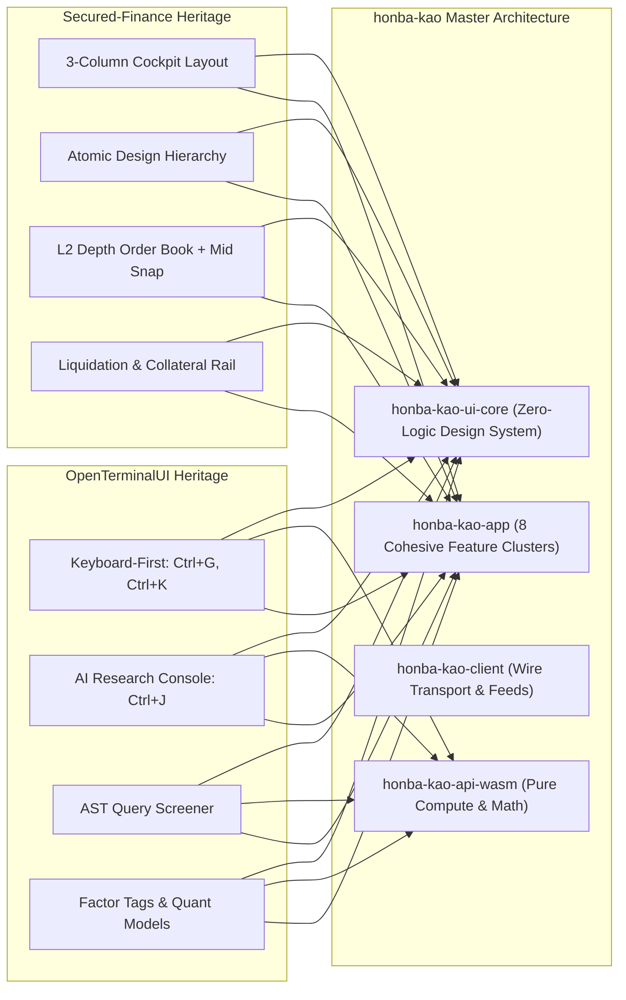
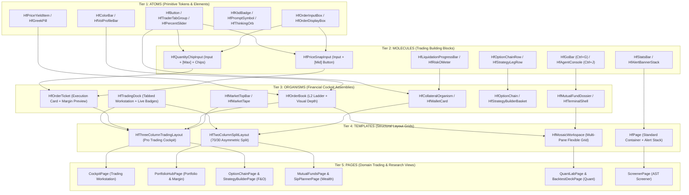
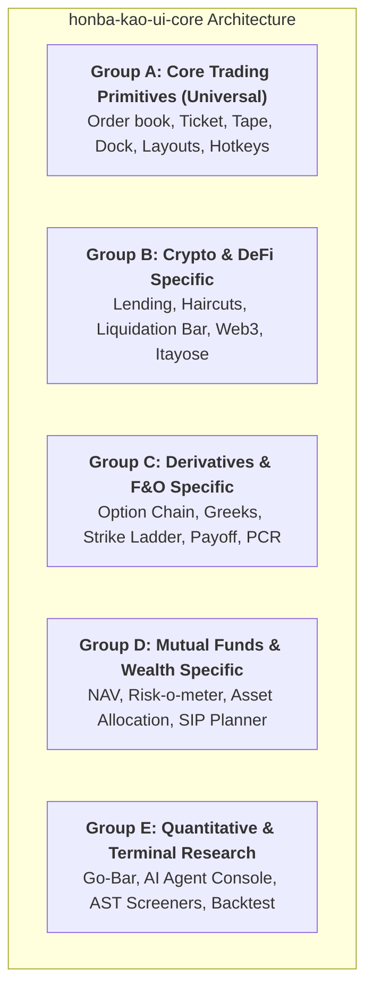
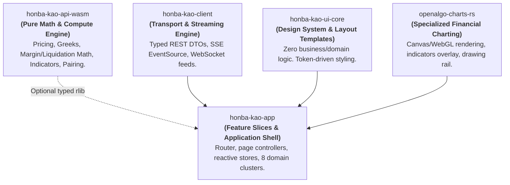

# Honba-Kao Unified Institutional Architecture: Atomic Design Hierarchy, Domain Classification, Component Equivalency & Feature De-Bloating Plan (v3.0 Master Specification)

**Author:** Antigravity Architect  
**Status:** Unified Master Specification (Approved Draft)  
**Target Crates:** `honba-kao-ui-core`, `honba-kao-app`, `honba-kao-api-wasm`, `honba-kao-client`, `openalgo-charts-rs`  
**Reference Codebases Audited Directly On Disk:**  
1. **Secured-Finance:** `/home/pmallapp/tmp/secured-finance-app/src/components` (54 Atoms, 45 Molecules, 37 Organisms, 6 Templates, 10 Pages)  
2. **OpenTerminalUI:** `/home/pmallapp/tmp/OpenTerminalUI/frontend/src/components` (229 Components across Terminal Primitives, Command Bar/Go Bar, AI Visuals, F&O, Mutual Funds, ETF, Crypto, Portfolio, Screener, Mosaic Workspace)  
**Date:** October 2026  

---

## Table of Contents
1. [Executive Summary & Problem Diagnosis](#1-executive-summary--problem-diagnosis)
   - 1.1 The Double Heritage: Secured-Finance + OpenTerminalUI
   - 1.2 The Root Cause of Bloat in `honba-kao-app/src/features/`
   - 1.3 The 5-Tier Atomic Financial Component Hierarchy
2. [Complete Equivalency Matrix: Atoms & Molecules](#2-complete-equivalency-matrix-atoms--molecules)
   - 2.1 Secured-Finance (`secured-finance-app`) All 54 Atoms
   - 2.2 Secured-Finance (`secured-finance-app`) All 45 Molecules
   - 2.3 Secured-Finance (`secured-finance-app`) All 37 Organisms & 6 Templates
   - 2.4 OpenTerminalUI Complete Terminal Design System & Feature Components
3. [Domain-Specific Grouping & Classification](#3-domain-specific-grouping--classification)
   - Group A: Core Trading & Terminal Primitives (Universal)
   - Group B: Crypto & DeFi Specific (Secured-Finance Heritage)
   - Group C: Derivatives & F&O Specific (Futures & Options)
   - Group D: Mutual Funds (MF) & Wealth Specific
   - Group E: Quantitative & Terminal Research Specific (OpenTerminalUI Heritage)
4. [Deep Dive: UI Layout & Architectural Patterns](#4-deep-dive-ui-layout--architectural-patterns)
   - 4.1 The Pro Trading Cockpit (`ThreeColumnsWithTopBar` / `HfThreeColumnTradingLayout`)
   - 4.2 The 70/30 Asymmetric Dual-Column Layout (`TwoColumns` / `HfTwoColumnSplitLayout`)
   - 4.3 The Multi-Tier Alert Hierarchy (`HfPage` & `HfAlertBannerStack`)
   - 4.4 The Terminal Hotkey & Mosaic Workspace (`HfMosaicWorkspace`)
5. [The 8-Cluster Feature De-Bloating Plan (`honba-kao-app/src/features/`)](#5-the-8-cluster-feature-de-bloating-plan-honba-kao-appsrcfeatures)
   - 5.1 The Consolidation Matrix: Collapsing 35 Directories into 8 Cohesive Clusters
   - 5.2 Evicting Compute from App to `honba-kao-api-wasm`
   - 5.3 Route Preservation & URL Compatibility in `router/paths.rs`
6. [Screen Restructuring Proposals](#6-screen-restructuring-proposals)
   - 6.1 Restructuring `features/trading` (The Trading Cockpit)
   - 6.2 Restructuring `features/portfolio` (The Portfolio & Margin Hub)
   - 6.3 Restructuring `features/derivatives` (Futures & Options Workstation)
   - 6.4 Designing `features/wealth` (Mutual Funds & Long-Term Planning)
   - 6.5 Restructuring `features/quant` (Quantitative Research & Simulator)
7. [Concrete Rust / Leptos Component Specifications](#7-concrete-rust--leptos-component-specifications)
   - 7.1 Layout Templates (`HfPage`, `HfThreeColumnTradingLayout`, `HfTwoColumnSplitLayout`)
   - 7.2 Universal Trading Primitives (`HfPriceSnapInput`, `HfQuantityChipInput`, `HfOrderBook`, `HfOrderTicket`, `HfTradingDock`)
   - 7.3 Crypto / DeFi Specific (`HfLiquidationProgressBar`, `HfCollateralHaircutTile`)
   - 7.4 Derivatives / F&O Specific (`HfOptionChainRow`, `HfOptionPayoffChart`)
   - 7.5 Mutual Funds & Wealth Specific (`HfRiskOMeter`, `HfSipCalculatorCard`)
   - 7.6 Quantitative & Terminal Research Specific (`HfGoBar`, `HfAgentConsole`)
8. [Multi-Crate Workspace Source Tree Mapping](#8-multi-crate-workspace-source-tree-mapping)
   - 8.1 Crate Dependency Graph (DAG) & Rules
   - 8.2 Top-Level Workspace Organization
   - 8.3 `honba-kao-ui-core` Detailed Source Tree
   - 8.4 `honba-kao-api-wasm` Detailed Source Tree
   - 8.5 `honba-kao-client` Detailed Source Tree
   - 8.6 `openalgo-charts-rs` Detailed Source Tree
   - 8.7 `honba-kao-app` Detailed Source Tree (The 8 Domain Clusters)
9. [Verification, Acceptance Criteria & Structural Invariants](#9-verification-acceptance-criteria--structural-invariants)
10. [Unified Migration & Phased Rollout Roadmap](#10-unified-migration--phased-rollout-roadmap)

---

## 1. Executive Summary & Problem Diagnosis

### 1.1 The Double Heritage: Secured-Finance + OpenTerminalUI
`honba-kao` elevates the retail finance interface into an institutional, high-velocity trading and research workstation. To achieve this, it marries two best-in-class architectural paradigms:

1. **Secured-Finance (`secured-finance-app`)**: Masterclass in **Atomic Trading Design** (`atoms` → `molecules` → `organisms` → `templates` → `pages`), single-viewport cockpit ergonomics (`ThreeColumnsWithTopBar`), asymmetric 70/30 portfolio management (`TwoColumns`), visual depth Level-2 order books, mid-snap price inputs, and dynamic liquidation/margin progress bars.
2. **OpenTerminalUI (`Hitheshkaranth/OpenTerminalUI`)**: Masterclass in **Bloomberg Terminal Keyboard Interaction**, rapid modal navigation (`Ctrl+G` GO-bar, `Ctrl+K` command palette), slide-over AI Research Agent (`Ctrl+J`) with live streaming thought bubbles and rich interactive artifact cards (`AiVisuals`), AST query screeners, and multi-asset research dossiers.



### 1.2 The Root Cause of Bloat in `honba-kao-app/src/features/`
Currently, `honba-kao-app/src/features/` contains **35 fragmented directories** totaling over 2.2 MB of source code:
* **The "Extras" Dumping Grounds**: `portfolio_extras`, `quant_extras`, `risk_ops_extras`, `system_extras`—catch-all junk drawers created when features outgrew their initial files.
* **Cockpit Fragmentation**: The Pro Trading experience is splintered across `workbench` (268K), `chart_workstation` (24K), `dom` (16K), `tape` (16K), `mta` (16K), `compare` (8K), and `launchpad` (16K). Instead of being unified under an institutional 3-column cockpit layout, each runs its own ad-hoc screen.
* **Quant & Research Sprawl**: `simulator` (696K), `strategy_studio` (292K), `backtesting` (12K), `model_lab` (12K), `stat_lab` (12K), `pair_trading` (12K), and `portfolio_lab` (12K) duplicate math, data loaders, and UI tables.
* **Compute Leaks**: Pure mathematical simulation engines, Monte Carlo path generators, Black-Scholes solvers, and execution pairing logic reside inside `honba-kao-app/src/features/simulator` (696K) instead of being isolated in `honba-kao-api-wasm`.
* **Missing Atomic Foundation**: Feature pages write bespoke buttons, inputs, and inline flexboxes because `honba-kao-ui-core` lacks the specialized financial atoms and molecules provided by Secured-Finance and OpenTerminalUI.

### 1.3 The 5-Tier Atomic Financial Component Hierarchy
Strict adherence to **Atomic Design** adapted for high-velocity financial trading governs all components:



---

## 2. Complete Equivalency Matrix: Atoms & Molecules

### 2.1 Secured-Finance (`secured-finance-app`) All 54 Atoms Audited

Direct audit of `/home/pmallapp/tmp/secured-finance-app/src/components/atoms`:

| # | Secured-Finance Atom | `honba-kao-ui-core` Equivalent | Description & Behavioral Semantics |
| :-: | :--- | :--- | :--- |
| 1 | `AssetInformation` | `HfAssetBadge` | Asset symbol, display name, and underlying contract/currency icon. |
| 2 | `Button` | `HfButton` | Design-token styled button with primary, secondary, ghost, danger, outline variants. |
| 3 | `Checkbox` | `HfCheckbox` | Accessible binary checkbox with indeterminate state for batch table selections. |
| 4 | `Chip` | `HfChip` | Compact interactive pill tag for filtering, status, or tag selection. |
| 5 | `CloseButton` | `HfCloseButton` | High-contrast icon button for dismissing modals, notifications, and toolbars. |
| 6 | `CollateralInformation` | `HfCollateralInfoRow` | Key-value row showing available collateral, haircut ratio, and max borrow. |
| 7 | `CollateralInformationTable`| `HfCollateralSummaryCell` | Micro-table row detailing asset-level collateral contribution. |
| 8 | `CollateralManagementConciseTab`| `HfCollateralSubTab` | Condensed tab trigger for switching between collateral assets. |
| 9 | `CollateralSelector` | `HfCollateralAssetSelect` | Dropdown trigger displaying asset icon, balance, and haircut rating. |
| 10 | `ColorBar` | `HfColorBar` | Cumulative depth background bar for L2 books (Emerald green / Crimson red). |
| 11 | `Counter` | `HfCounter` | Monospace animated counter for active trades, open orders, or fills. |
| 12 | `CurrencyIcon` | `HfCurrencyIcon` | SVG icon representing fiat or crypto currency (₹, $, BTC, ETH, USDC). |
| 13 | `CurrencyItem` | `HfCurrencyListItem` | Currency dropdown option showing icon, symbol, and available cash. |
| 14 | `CurveHeaderAsset` | `HfCurveAssetTag` | Tag highlighting the active asset curve in multi-curve yield graphs. |
| 15 | `CurveHeaderTotal` | `HfCurveTotalSummary` | Aggregate TVL or total volume header on yield curve visualizations. |
| 16 | `DelistingChip` | `HfDelistingChip` | Amber/red notice pill warning of upcoming instrument delisting or expiry. |
| 17 | `DropdownSelector` | `HfSelect` | Accessible styled select control for tenors, intervals, and order types. |
| 18 | `ErrorInfo` | `HfInlineError` | Monospace red warning indicator with error text for invalid form states. |
| 19 | `ExpandIndicator` | `HfExpandIndicator` | Chevron glyph indicating collapsible table rows or drawer expansion. |
| 20 | `Footer` | `HfFooterBar` | Terminal footer status bar with latency, block height, and protocol status. |
| 21 | `FormatCollateralUsage` | `HfCollateralUsageText` | Color-graded text cell (safe/caution/danger) for collateral utilization %. |
| 22 | `GradientBox` | `HfGradientBox` | Visual container with token-based gradient border for highlighted cards. |
| 23 | `HighlightChip` | `HfHighlightChip` | Subtle glowing badge for "New", "Featured", or "Active" items. |
| 24 | `HorizontalListItem` | `HfHorizontalListItem` | Compact inline list cell for ticker summaries and telemetry feeds. |
| 25 | `Identicon` | `HfIdenticon` | Procedural account avatar glyph generated from wallet or broker address. |
| 26 | `InputBase` | `HfInput` | Foundational styled text/number input element with focus borders. |
| 27 | `MarketTab` | `HfMarketTab` | High-contrast tab toggle for switching between market categories. |
| 28 | `MenuItem` | `HfMenuItem` | Accessible dropdown menu item with hotkey hint and icon support. |
| 29 | `OrderBookIcon` | `HfOrderBookIcon` | SVG icon representing order book depth modes (bids, asks, both). |
| 30 | `OrderBookInfoTooltip` | `HfOrderBookTooltip` | Tooltip explaining depth aggregation multipliers and click-to-fill. |
| 31 | `OrderDisplayBox` | `HfOrderDisplayBox` | Read-only tabular key-value display for execution prices, yields, notionals. |
| 32 | `OrderInputBox` | `HfOrderInputBox` | Numeric input with currency adornment (₹, $, USDC), precision mask, monospace tnum. |
| 33 | `PercentageTab` | `HfPercentTab` | Quick-size tab toggle (25%, 50%, 75%, 100%) for order ticket sizing. |
| 34 | `PriceYieldItem` | `HfPriceYieldItem` | Two-tier display coupling cash price with derived APR, YTM, or option IV. |
| 35 | `RadioButton` | `HfRadioButton` | Accessible radio option button with custom terminal indicator. |
| 36 | `Section` | `HfSection` | Structured card content section with header, divider, and padding. |
| 37 | `SectionWithItems` | `HfSectionGrid` | Section hosting a grid of key-value parameter cells. |
| 38 | `Selector` | `HfSegmentSelector` | Horizontal pill selector for binary or ternary mode switching. |
| 39 | `Separator` | `HfSeparator` | Accessible horizontal or vertical divider stroke. |
| 40 | `SimpleAdvancedSelector`| `HfTradingModeToggle`| Toggle between Standard Mode (simplified) and Pro Mode (cockpit). |
| 41 | `Slider` | `HfPercentSlider` | Snapping track slider with 0%, 25%, 50%, 75%, 100% tick marks. |
| 42 | `SortArrows` | `HfSortArrows` | Tri-state table sorting indicator (Neutral, Ascending, Descending). |
| 43 | `Spinner` | `HfSpinner` | Monospace / SVG loading indicator for asynchronous data streams. |
| 44 | `StatsBox` | `HfMetricTile` | Compact metric box showing label, monospace value, and delta badge. |
| 45 | `SubTab` | `HfSubTab` | Secondary navigation tab for sub-views within complex panels. |
| 46 | `SupportedNetworks` | `HfNetworkCluster` | Grouped chain/exchange icons showing operational connectivity. |
| 47 | `Tab` | `HfTab` | Primary tab trigger used in layout navigation. |
| 48 | `TextLink` | `HfLink` | Accessible link element with external indicator icon and hover states. |
| 49 | `TimeScaleCheckbox` | `HfTimeScaleOption` | Checkbox controlling timeframe visibility in multi-chart setups. |
| 50 | `Timer` | `HfAuctionTimer` | Monospace countdown clock for call auction uncrossing or session phase. |
| 51 | `Toggle` | `HfToggle` | Accessible binary toggle switch for live mode, crosshair sync, etc. |
| 52 | `TraderProTab` | `HfTraderTabGroup` | Terminal-style Buy/Sell and Order Type switcher tabs. |
| 53 | `WalletSourceSelector` | `HfBrokerSourceSelect` | Selector between Linked Broker (Zerodha/AngelOne) and Paper Wallet. |
| 54 | `ZCTokenIcon` | `HfDerivativeTokenIcon`| Specialized token badge for zero-coupon or synthetic contracts. |

---

### 2.2 Secured-Finance (`secured-finance-app`) All 45 Molecules Audited

Direct audit of `/home/pmallapp/tmp/secured-finance-app/src/components/molecules`:

| # | Secured-Finance Molecule | `honba-kao-ui-core` Equivalent | Description & Behavioral Semantics |
| :-: | :--- | :--- | :--- |
| 1 | `AdvancedLendingEstimationFields` | `HfEstimationFields` | Real-time computed trade preview: Notional, Fees (bps), Margin Impact, Leverage. |
| 2 | `AdvancedLendingTopBar` | `HfMarketTopBar` | Instrument header: Ticker, LTP, 24h delta, Mark/Index, phase timer. |
| 3 | `Alert` | `HfAlertBanner` | Contextual alert banner with info, warning, error, and success states. |
| 4 | `AmountCard` | `HfAmountCard` | Card pairing raw quantity, monetary valuation, and currency tag. |
| 5 | `AssetDisclosure` | `HfAssetDisclosure` | Collapsible legal / risk disclosure block for specific assets. |
| 6 | `AssetSelector` | `HfAssetSelector` | Searchable asset selector dropdown with market cap and 24h volume. |
| 7 | `BarChart` | `HfBarChart` | Lightweight SVG bar chart for volume distribution and order depth. |
| 8 | `CollateralProgressBar` | `HfCollateralProgressBar`| Visual bar showing collateral consumed vs. total deposited collateral. |
| 9 | `CollateralSimulationSection` | `HfCollateralSimulator` | Before vs. after impact simulation for collateral deposits/withdrawals. |
| 10 | `CollateralSnapshot` | `HfCollateralSnapshot` | Summary card of account health, total collateral value, and borrow capacity. |
| 11 | `CollateralTabLeftPane` | `HfCollateralAssetPane` | Left panel of collateral manager listing deposited asset positions. |
| 12 | `CollateralTabRightPane` | `HfCollateralActionPane` | Right panel of collateral manager hosting deposit/withdraw inputs. |
| 13 | `CollateralUsageSection` | `HfCollateralUsageSection`| Visual breakdown of collateral pledged across open trading desks. |
| 14 | `CoreTable` | `HfTable` | High-performance virtualized data table with sortable headers. |
| 15 | `CurrencyDropdown` | `HfCurrencyDropdown` | Dropdown selector for quote and base currencies. |
| 16 | `CurrencyMaturityDropdown` | `HfTenorDropdown` | Dual selector combining instrument ticker and expiration/tenor date. |
| 17 | `CurveHeader` | `HfCurveHeader` | Header bar above yield and volatility curves with multi-tenor stats. |
| 18 | `DelistedCurrencyDisclaimer` | `HfDelistedDisclaimer` | Banner notifying user of ceased trading on a delisted asset. |
| 19 | `Dialog` | `HfDialog` | Accessible modal dialog with focus trap and escape-key handling. |
| 20 | `FailurePanel` | `HfFailurePanel` | Error state panel with error code, explanation, and retry button. |
| 21 | `HamburgerMenu` | `HfMobileMenu` | Mobile navigation menu toggle and slide-over panel. |
| 22 | `HistoricalChart` | `HfHistoricalChart` | Historical line/candlestick chart with interval selectors. |
| 23 | `HorizontalTab` | `HfHorizontalTabBar` | Horizontal tab strip with active border indicator. |
| 24 | `InfoToolTip` | `HfTooltip` | Hover tooltip providing financial formula explanations. |
| 25 | `LineChart` | `HfLineChart` | Interactive SVG line chart with crosshair value tracker. |
| 26 | `LiquidationProgressBar` | `HfLiquidationProgressBar`| Multi-zone risk gauge with buffer tick and liquidation price preview. |
| 27 | `MenuPopover` | `HfPopover` | Floating popover menu positioned relative to trigger element. |
| 28 | `MultiLineChart` | `HfMultiLineChart` | Multi-series chart comparing benchmark index vs. portfolio NAV. |
| 29 | `MyWalletCard` | `HfWalletCard` | Account card displaying cash, buying power, linked broker latency. |
| 30 | `NetworkSelector` | `HfNetworkSelector` | Switcher between live trading, paper trading, and testnet environments. |
| 31 | `PercentageSelector` | `HfPercentChipGroup` | Grouped chips (`[25%]`, `[50%]`, `[75%]`, `[100%]`) for order sizing. |
| 32 | `Settings` | `HfSettingsPanel` | User preferences panel (slippage tolerance, default order type, theme). |
| 33 | `StatsBar` | `HfStatsBar` | Horizontal metric strip (NAV, Available Margin, Realized/Unrealized P&L). |
| 34 | `SubtabGroup` | `HfSubtabGroup` | Compact subtab group for secondary view filtering. |
| 35 | `SuccessPanel` | `HfSuccessPanel` | Success confirmation panel with order ID and transaction details. |
| 36 | `TabGroup` | `HfTabGroup` | Coordinated tab bar controlling visible workspace views. |
| 37 | `TabSelector` | `HfTabSelector` | Segmented tab selector for side-by-side mode switching. |
| 38 | `TableActionMenu` | `HfRowActionMenu` | Contextual action dropdown on table rows (Amend, Cancel, Close, SL/TP). |
| 39 | `TableCardHeader` | `HfTableHeader` | Table header card with search filter, column chooser, and export button. |
| 40 | `TableContractCell` | `HfContractCell` | Table cell displaying contract ticker, tenor, and instrument badge. |
| 41 | `TableHeader` | `HfTableHeaderRow` | Header row of a virtualized table with sort arrows and column resize grips. |
| 42 | `TermSelector` | `HfTermSelector` | Maturity date selector pills (1M, 3M, 6M, 1Y) with annualized yield rates. |
| 43 | `TimeScaleSelector` | `HfTimeframeSelector` | Timeframe switcher (1m, 5m, 15m, 1h, 1D, 1W) for chart views. |
| 44 | `Tooltip` | `HfTooltip` | Design-token styled accessible hover tooltip. |
| 45 | `WalletRadioGroup` | `HfAccountRadioGroup` | Radio group selecting active funding account or broker profile. |

---

### 2.3 Secured-Finance All 37 Organisms & 6 Templates Audited

Direct audit of `/home/pmallapp/tmp/secured-finance-app/src/components/organisms` and `src/components/templates`:

> [!NOTE]
> **Filesystem Item Count Clarification**:
> A filesystem listing (`ls -1`) of the Secured-Finance component directories yields:
> - `atoms/`: **55 items** (54 component directories + 1 barrel export `index.ts`)
> - `molecules/`: **46 items** (45 component directories + 1 barrel export `index.ts`)
> - `organisms/`: **38 items** (37 component directories + 1 barrel export `index.ts`)
> - `templates/`: **7 items** (6 component directories + 1 barrel export `index.ts`)
>
> In the Honba-Kao Rust / Leptos architecture, each directory's TypeScript `index.ts` barrel maps directly to the corresponding module declaration file (`mod.rs`), maintaining zero-overhead public re-exports.

#### Complete Organisms Equivalency Matrix (All 37 Organisms Audited)

| # | Secured-Finance Organism | `honba-kao` Target Component | Target Crate / Module | Description & Architectural Semantics |
| :-: | :--- | :--- | :--- | :--- |
| **—** | `index.ts` | `organisms/mod.rs` | `honba-kao-ui-core::organisms` | Public re-export barrel declaring complex financial organisms. |
| 1 | `ActiveTradeTable` | `HfPositionsTable` | `ui-core::trading` / `features/trading` | Virtualized table of open positions with mark price, P&L, ROE %, and instant close/repay actions. |
| 2 | `AdvancedLending` | `HfTradingCockpit` | `features/trading/cockpit_page.rs` | Master 3-column assembly coordinating Chart, L2 Depth Ladder, Order Ticket, and Workstation Dock. |
| 3 | `AdvancedLendingOrderCard` | `HfOrderTicket` | `ui-core::organisms::order_ticket` | Institutional order ticket with side tabs, mid snap, quantity chips, and real-time margin/fee impact. |
| 4 | `CollateralInput` | `HfCollateralInput` | `ui-core::molecules::crypto` | Quantitative collateral amount entry with max balance fill, asset switch, and valuation impact. |
| 5 | `CollateralOrganism` | `HfCollateralOrganism` | `ui-core::organisms::collateral_organism` | Multi-asset collateral manager with haircut evaluation, borrow power, and deposit/withdraw split. |
| 6 | `CollateralTab` | `HfCollateralManager` | `features/portfolio/portfolio_page.rs` | Collateral dashboard tabbed coordinator managing position breakdowns and pledging workflows. |
| 7 | `ConnectWalletCard` | `HfConnectBrokerCard` | `features/system/auth_page.rs` | Broker & wallet authentication gateway (supports Zerodha Kite, Angel One, Paper Wallet, Web3). |
| 8 | `DepositCollateral` | `HfCollateralDepositModal` | `ui-core::organisms` / `features/portfolio` | Multi-step dialog with allowance check and transfer execution for collateral deposit. |
| 9 | `DepositZCToken` | `HfDepositDerivativeModal` | `ui-core::organisms` / `features/derivatives` | Deposit flow for tokenized forward/zero-coupon derivative contracts. |
| 10 | `EmergencyRedeemDialog` | `HfKillSwitchDialog` | `features/risk_ops/ops_page.rs` | Emergency settlement and circuit-breaker unwind dialog for default or delisting conditions. |
| 11 | `GlobalItayoseMultiCurveChart` | `HfAuctionTermStructureChart` | `openalgo-charts-rs::curves` | Yield curve visualizer for call-auction (Itayose) session pricing across currency tenors. |
| 12 | `Header` | `HfHeaderBar` | `honba-kao-app::router::chrome` | Top application header with brand, instrument search, account switcher, and system latency. |
| 13 | `HistoricalWidget` | `HfHistoricalWidget` | `features/trading` / `features/research` | Coordinated tabbed widget combining historical trades, execution tape, and historical charts. |
| 14 | `LendingCard` | `HfQuickTradeCard` | `features/wealth/bonds_page.rs` | Simplified fixed-income order entry card for non-pro investors with preset maturities and APYs. |
| 15 | `LineChartTab` | `HfYieldCurveTab` | `openalgo-charts-rs::curves` | Single-tenor historical curve viewer tab with interval and maturity toggles. |
| 16 | `MarketInfoDialog` | `HfContractSpecsDialog` | `ui-core::organisms` / `features/research` | Detailed modal displaying contract specs, tick size, lot size, expiry rules, and haircut schedule. |
| 17 | `MarketLoanWidget` | `HfMarketLoanMatrix` | `features/derivatives` / `features/wealth` | Matrix displaying active market borrowing/lending depth and annualized yield curve rates. |
| 18 | `MultiCurveChart` | `HfYieldCurveOrganism` | `openalgo-charts-rs::curves` | Multi-tenor interest rate yield curves comparing current rates, previous close, and benchmark curves. |
| 19 | `MultiLineChartTab` | `HfMultiCurveTab` | `openalgo-charts-rs::curves` | Tabbed wrapper for comparative multi-asset yield curve overlays. |
| 20 | `MyTransactionsTable` | `HfTransactionAuditTable` | `features/portfolio/tradebook_page.rs` | Immutable transaction ledger displaying order fills, settlements, deposit/withdraw receipts, and hashes. |
| 21 | `MyWalletWidget` | `HfWalletSummaryWidget` | `ui-core::organisms` / `features/portfolio` | Full account balance widget showing cash, margin consumed, available buying power, and collateral ratio. |
| 22 | `NewOrderBookWidget` | `HfOrderBook` | `ui-core::trading::order_book` | Level-2 depth ladder with visual volume fill bars, aggregation grouping, and click-to-fill price/qty. |
| 23 | `OrderAction` | `HfOrderActionBar` | `ui-core::trading::trading_dock` | Contextual action toolbar above active orders with "Cancel All", "Flatten", and filter toggles. |
| 24 | `OrderDetails` | `HfOrderReceiptCard` | `ui-core::organisms` | Post-trade and pre-trade execution receipt showing fees, slippage, fill price, and effective yield. |
| 25 | `OrderHistoryTable` | `HfOrderHistoryTable` | `ui-core::trading::trading_dock` | Historical order audit journal showing filled, canceled, rejected, and expired orders. |
| 26 | `OrderTable` | `HfOpenOrdersTable` | `ui-core::trading::trading_dock` | Real-time working orders table with live modify (price/qty) and single-click cancellation. |
| 27 | `PlaceOrder` | `HfOrderConfirmationModal` | `ui-core::organisms` | Modal confirmation prompt displaying order summary, leverage risk, and biometric/pin confirmation. |
| 28 | `RecentTradesTable` | `HfRecentTradesTable` | `ui-core::trading` / `features/trading` | Streaming time & sales tape showing execution price, trade size, buyer/seller aggressor side, and time. |
| 29 | `RemoveOrderDialog` | `HfCancelOrderModal` | `ui-core::organisms` | Confirmation modal for cancelling working limit or stop orders. |
| 30 | `UnwindDialog` | `HfClosePositionModal` | `ui-core::organisms` / `features/trading` | Position unwind modal calculating realized P&L, slippage, and net funds returned upon closing. |
| 31 | `WalletPopover` | `HfAccountPopover` | `honba-kao-app::router::chrome` | Header floating popover showing quick account balances, active broker session, and disconnect action. |
| 32 | `WithdrawCollateral` | `HfCollateralWithdrawModal` | `features/portfolio/portfolio_page.rs` | Modal flow for withdrawing pledged collateral with real-time margin safety checks. |
| 33 | `WithdrawPositionTable` | `HfSettlementTable` | `features/portfolio` | Table of mature/liquidated positions ready for settlement redemption. |
| 34 | `WithdrawTokenTable` | `HfVaultBalancesTable` | `features/portfolio` | Table of unencumbered balances sitting in exchange/settlement vaults available for transfer. |
| 35 | `WithdrawZCToken` | `HfWithdrawDerivativeModal` | `features/derivatives` | Modal for redeeming or transferring tokenized zero-coupon or future contracts at maturity. |
| 36 | `YieldChart` | `HfYieldChart` | `openalgo-charts-rs::curves` | Interactive canvas/SVG chart for plotting tenor vs. annualized yield rate curves. |
| 37 | `ZCTokenInput` | `HfDerivativeContractInput` | `ui-core::primitive::input` | Specialized contract input handling notional units and maturity discount values. |

#### Complete Templates Equivalency Matrix (All 6 Templates Audited)

| # | Secured-Finance Template | `honba-kao` Equivalent | Architectural Destination & Behavioral Semantics |
| :-: | :--- | :--- | :--- |
| **—** | `index.ts` | `templates/mod.rs` | Public re-export barrel declaring layout grid templates. |
| 1 | `Closable` | `HfClosablePanel` | `ui-core::primitive::panel`: Dockable panel container with title bar, minimize/maximize buttons, and close action. |
| 2 | `EmergencySettlementStep` | `HfSettlementStepContainer` | `ui-core::templates`: Multi-step container card for phased settlement and default unwinding. |
| 3 | `Layout` | `HfAppChrome` | `honba-kao-app/src/router/chrome/app_chrome.rs`: Root chrome mounting NavRail, HeaderBar, Viewport Outlet, and SiteFooter. |
| 4 | `Page` | `HfPage` | `ui-core::templates::page.rs`: Standard page boundary wrapper enforcing max bounds, padding, alert stack slots, and metadata. |
| 5 | `ThreeColumnsWithTopBar` | `HfThreeColumnTradingLayout` | `ui-core::templates::three_columns.rs`: 3-column institutional trading cockpit (Top Bar + Chart + Order Book + Ticket + Spanning Dock). |
| 6 | `TwoColumns` | `HfTwoColumnSplitLayout` | `ui-core::templates::two_columns.rs`: 70/30 asymmetric split cleanly separating primary data tables from telemetry/actions. |

### 2.4 OpenTerminalUI Complete Design System & Feature Components Audited

Direct audit of `/home/pmallapp/tmp/OpenTerminalUI/frontend/src/components`:

| Subsystem / Path | Component Name | `honba-kao-ui-core` Equivalent | Description & Behavioral Semantics |
| :--- | :--- | :--- | :--- |
| `terminal/` | `TerminalInput` | `HfTerminalInput` | High-contrast monospace command prompt input with blink cursor. |
| `terminal/` | `TerminalDropdown` | `HfTerminalDropdown` | Keyboard-navigable dropdown menu with quick index jumping. |
| `terminal/` | `TerminalTable` | `HfTerminalTable` | Bloomberg-dense tabular data grid with zero-padding cells. |
| `terminal/` | `TerminalToast` | `HfTerminalToast` | Minimalist non-blocking status notification. |
| `terminal/` | `TerminalTooltip` | `HfTerminalTooltip` | Fast-rendering data point inspector for terminal screens. |
| `terminal/` | `SentimentBadge` | `HfSentimentBadge` | Directional sentiment pill (Bullish, Bearish, Neutral) with color intensity. |
| `layout/` | `CommandBar` | `HfGoBar` | Bloomberg-style `Ctrl+G` modal input with instant symbol and route auto-complete. |
| `layout/` | `CommandPalette` | `HfCommandPalette` | `Ctrl+K` action runner with command search, keyboard shortcuts, and theme switcher. |
| `layout/` | `LaunchpadGrid` | `HfLaunchpadGrid` | Resizable tile grid for multi-asset monitoring and watchlist widgets. |
| `layout/` | `HudOverlay` | `HfHudOverlay` | Terminal heads-up display overlay showing market state and system health. |
| `ai/` | `AiVisuals` | `HfAiArtifactCard` | Interactive card rendering AI-generated structured artifacts (valuation matrices, thesis summaries, scenario tables). |
| `trading/` | `HotKeyPanel` | `HfHotKeyBar` | Persistent footer bar displaying active keyboard shortcuts (`[F1] Help`, `[F2] Buy`, `[F3] Sell`). |
| `trading/` | `HotKeyPanelFloat`| `HfHotKeyPalette` | Floating modal listing all workspace keyboard navigation commands. |
| `market/` | `DepthChart` | `HfDepthVisualizer` | Cumulative bid/ask depth visualizer with mid-market crosshair. |
| `market/` | `TimeSalesTape` | `HfTapeRow` / `HfTape` | Real-time streaming print tape with buyer/seller aggressor color tokens. |
| `market/` | `FuturesPanel` | `HfFuturesLadder` | Futures contract matrix showing near/next/far month basis and open interest. |
| `mutualFunds/` | `MutualFundSearch` | `HfMutualFundSearch` | Specialized fund lookup with category filter and direct/regular options. |
| `mutualFunds/` | `SIPCalculator` | `HfSipCalculatorCard` | Interactive wealth projection calculator with monthly investment slider. |
| `mutualFunds/` | `MutualFundDetail` | `HfMutualFundDossier` | Fact-sheet displaying NAV, Risk-o-meter, asset allocation, and top holdings. |
| `mutualFunds/` | `RollingReturns` | `HfRollingReturnsVisualizer`| Rolling return consistency chart comparing fund performance against benchmark index. |
| `crypto/` | `CryptoOverview` | `HfCryptoOverview` | High-frequency crypto market dashboard with 24h volume and funding rates. |
| `crypto/` | `CryptoDefiPanel` | `HfCryptoDefiPanel` | Lending/borrowing telemetry, collateral ratios, and liquidation monitors. |
| `etf/` | `HoldingsViewer` | `HfEtfHoldingsTable` | Underlying stock breakdown table with constituent weights and sector tags. |
| `etf/` | `OverlapAnalysis` | `HfPortfolioOverlapPill` | Pairwise portfolio overlap percentage indicator. |
| `portfolio/` | `RiskMetricsPanel` | `HfRiskMetricsPanel` | Value at Risk (VaR), Sharpe, Sortino, and Beta telemetry tiles. |
| `portfolio/` | `AllocationChart` | `HfAssetAllocationBar` | Multi-asset allocation breakdown (Equity, Fixed Income, Cash, Crypto). |
| `backtesting/` | `MosaicWorkspace` | `HfMosaicWorkspace` | Multi-pane flexible grid with dynamic resizing and keyboard pane focus. |
| `backtesting/` | `BacktestingTradingChart`| `HfBacktestChart` | Equity curve with trade entry/exit markers and drawdown underwater panel. |
| `screener/` | `ScreenerBuilder` | `HfQueryBuilder` | Visual AST predicate builder for complex fundamental and technical filters. |
| `screener/` | `FactorSelector` | `HfFactorTag` | Multi-select factor rating chips (Momentum, Value, Quality, Low Vol). |
| `filings/` | `FilingsWorkspace` | `HfFilingsCard` | Corporate filing extract with highlighted entity mentions and sentiment tagging. |

---

## 3. Domain-Specific Grouping & Classification



### Group A: Core Trading & Terminal Primitives (Universal)
* **Atoms (15)**: `HfOrderInputBox`, `HfOrderDisplayBox`, `HfColorBar`, `HfSortArrows`, `HfStatusChip`, `HfTraderTabGroup`, `HfTickArrow`, `HfStatusLed`, `HfKbdBadge`, `HfSplitterHandle`, `HfButton`, `HfInput`, `HfCheckbox`, `HfToggle`, `HfSeparator`.
* **Molecules (10)**: `HfPriceSnapInput`, `HfQuantityChipInput`, `HfSpreadIndicator`, `HfStatsBar`, `HfTapeRow`, `HfEstimationFields`, `HfAlertBannerStack`, `HfWatchlistTile`, `HfMultiChartSyncHeader`, `HfTimeframeSelector`.
* **Organisms (5)**: `HfOrderBook`, `HfOrderTicket`, `HfTradingDock`, `HfMarketTopBar`, `HfMarketTape`.
* **Templates (4)**: `HfThreeColumnTradingLayout`, `HfTwoColumnSplitLayout`, `HfMosaicWorkspace`, `HfPage`.

### Group B: Crypto & DeFi Specific (Secured-Finance Heritage)
* **Atoms (8)**: `HfAssetIcon`, `HfNetworkPill`, `HfAuctionTimer`, `HfTxHashChip`, `HfGasFeeBadge`, `HfDelistedChip`, `HfIdenticon`, `HfDerivativeTokenIcon`.
* **Molecules (8)**: `HfLiquidationProgressBar`, `HfCollateralHaircutTile`, `HfWalletSummaryWidget`, `HfBorrowLimitGauge`, `HfFundingRateTile`, `HfItayosePhaseCard`, `HfTermSelector`, `HfCollateralSimulator`.
* **Organisms (3)**: `HfCollateralOrganism`, `HfYieldCurveOrganism`, `HfCryptoDefiPanel`.

### Group C: Derivatives & F&O Specific (Futures & Options)
* **Atoms (6)**: `HfMoneynessBadge` (`ITM`, `ATM`, `OTM`), `HfGreekPill` ($\Delta, \Gamma, \Theta, 
u, 
ho$), `HfStrikePriceCell`, `HfOiBar`, `HfIvDisplay`, `HfFuturesBasisBadge`.
* **Molecules (8)**: `HfOptionChainRow`, `HfGreeksMetricGroup`, `HfStrategyLegRow`, `HfPcrMeter`, `HfMaxPainBadge`, `HfOptionPayoffChart`, `HfRollOptionTicket`, `HfFuturesLadder`.
* **Organisms (2)**: `HfOptionChain`, `HfStrategyBuilderBasket`.

### Group D: Mutual Funds (MF) & Wealth Specific
* **Atoms (6)**: `HfNavBox`, `HfExpenseRatioChip`, `HfAumBadge`, `HfFundCategoryChip`, `HfLockInTimer`, `HfExitLoadAlert`.
* **Molecules (7)**: `HfRiskOMeter` (SEBI 6-tier dial), `HfAssetAllocationBar`, `HfPortfolioOverlapPill`, `HfSipCalculatorCard`, `HfFundManagerCard`, `HfRollingReturnsVisualizer`, `HfPlanTypeToggle`.
* **Organisms (2)**: `HfMutualFundDossier`, `HfSipBasketOrganizer`.

### Group E: Quantitative & Terminal Research Specific (OpenTerminalUI Heritage)
* **Atoms (8)**: `HfPromptSymbol`, `HfThinkingOrb`, `HfFocusBeam`, `HfFactorTag`, `HfSparklinePrimitive`, `HfVolProfileBar`, `HfSentimentBadge`, `HfProvenanceChip`.
* **Molecules (10)**: `HfGoBar` (`Ctrl+G`), `HfCommandPalette` (`Ctrl+K`), `HfAgentConsole` (`Ctrl+J`), `HfAiArtifactCard`, `HfFilterPill`, `HfBacktestMetricCard`, `HfUnderwaterGauge`, `HfCointegrationBand`, `HfMarketRegimeBadge`, `HfFilingsCard`.
* **Organisms (3)**: `HfTerminalShell`, `HfResearchAgentDock`, `HfQueryBuilder`.

---

## 4. Deep Dive: UI Layout & Architectural Patterns

### 4.1 The Pro Trading Cockpit (`ThreeColumnsWithTopBar` / `HfThreeColumnTradingLayout`)

```
+-------------------------------------------------------------------------------------------------------+
|  HfMarketTape: [★ BTC-DEC24 4.82% +12bps] [★ RELIANCE ₹2,940 +1.2%] [★ NIFTY 24,520 +0.45%]          |
+-------------------------------------------------------------------------------------------------------+
|  HfMarketTopBar:                                                                                      |
|  [Asset: RELIANCE ▼] [Tenor: 28NOV24 ▼]  LTP: ₹2,942.50  VWAP: ₹2,938  24h: +1.42%  Vol: 4.8M [OPEN]  |
+----------------------------------------------------+--------------------------+-----------------------+
|  COLUMN 1 (Visualizer):                            |  COLUMN 2 (Market Depth):|  COLUMN 3 (Ticket):   |
|  [Tab: Candlestick / OpenAlgo Chart]               |  [Tab: L2 Book / Trades] |  [BUY] [SELL]         |
|                                                    |  Agg: [0.05 ▼] Mode:[All]|  Type: [Limit ▼]      |
|  +----------------------------------------------+  |  Asks:                   |  Price: [2942.50][Mid]|
|  |                                              |  |  2943.00  1,240  ████    |  Qty:   [500    ][Max]|
|  |           Interactive Chart                  |  |  2942.75    850  ██      |  [%: 25 | 50 | 75 |100|
|  |           (OpenAlgo / Canvas)                |  |  2942.50  2,100  ██████  |  -------------------  |
|  |                                              |  |  Spread: 0.25 (0.008%)   |  Est. Value: ₹147,125 |
|  +----------------------------------------------+  |  Bids:                   |  Fee: ₹14.71 (1 bp)   |
+----------------------------------------------------+  2942.25  1,500  █████   |  Margin Impact:       |
|  BOTTOM WORKSTATION DOCK (Spans Columns 1 & 2):    |  2942.00  3,400  ████████|  [== 34% -> 48% ==]   |
|  [Active Positions (2)] [Open Orders (3)] [History]|  2941.75    600  ██      |  [ PLACE ORDER BUTTON]|
|  --------------------------------------------------+--------------------------+-----------------------+
|  Symbol    Side   Size   Entry Px   Mark Px   Unrealized P&L   ROE %    Liquidation Px   Actions        |
|  RELIANCE  LONG   500    ₹2,890     ₹2,942.50 +₹26,250.00      +1.81%   ₹2,420           [Close] [SL/TP]|
|  NIFTY-FUT SHORT  150    ₹24,600    ₹24,520   +₹12,000.00      +0.32%   ₹25,100          [Close] [SL/TP]|
+-------------------------------------------------------------------------------------------------------+
```

#### Layout Invariants:
1. **Vertical Bounds**: Fits standard 1080p and 1440p viewports without page-level scrollbars; scrolling is isolated to internal viewports.
2. **Unified Data Coordination**: The `TopBar`, `OrderBook`, `Chart`, and `OrderTicket` synchronize through a centralized trading context. Changing the asset updates all columns simultaneously.
3. **Click-to-Trade Integration**:
   - Clicking any row in the Order Book auto-populates the Order Ticket with the selected price and cumulative size.
   - The Order Ticket's **"Mid"** button snaps to `(best_bid + best_ask) / 2.0`.
   - The **"Max"** button computes buying power based on available collateral and margin haircut.

### 4.2 The 70/30 Asymmetric Dual-Column Layout (`TwoColumns` / `HfTwoColumnSplitLayout`)

```
+-------------------------------------------------------------------------------------------------------+
|  HfPage Header: Portfolio Management            [Brokers: 3 Connected]   [Latency: 8ms]               |
+-------------------------------------------------------------------+-----------------------------------+
|  LEFT COLUMN (70% Width - Analysis & Positions):                  |  RIGHT COLUMN (30% - Telemetry):  |
|                                                                   |                                   |
|  HfStatsBar: [NAV: ₹4,850,000] [Day PnL: +₹42,500] [Margin: 42%]  |  HfWalletCard:                    |
|                                                                   |  Total Buying Power: ₹2,810,000   |
|  Collateral Management Section:                                   |  Available Cash:     ₹1,050,000   |
|  Asset     Balance    Haircut   Collateral Value  Status          |  Allocated Margin:   ₹1,760,000   |
|  CASH      ₹1,000,000 100%      ₹1,000,000        Eligible        |  -------------------------------- |
|  TCS       500 sh     80%       ₹1,580,000        Eligible        |  HfLiquidationProgressBar:        |
|  INFY      800 sh     80%       ₹1,184,000        Eligible        |  [Low Risk =================]     |
|                                                                   |  Buffer to Margin Call: +58.0%    |
|  HfTradingDock:                                                   |  -------------------------------- |
|  [Holdings (12)] [Active Positions (4)] [Working Orders (2)]       |  Quick Actions:                   |
|  +-------------------------------------------------------------+  |  [ Deposit Funds ] [ Withdraw ]   |
|  | Standardized Virtualized Table with inline risk badges      |  |  [ Transfer Margin ]              |
|  +-------------------------------------------------------------+  +-----------------------------------+
+-------------------------------------------------------------------------------------------------------+
```

### 4.3 The Multi-Tier Alert Hierarchy (`HfPage` & `HfAlertBannerStack`)
Secured-Finance treats alerts not as dismissible floating toasts, but as structural notification headers positioned above workspace content:
- **System Tier (Severity: Critical/Warning)**: Downtime alerts, settlement transitions, delisting deadlines.
- **Risk Tier (Severity: Warning/Error)**: Approaching liquidation threshold (>80% margin usage), account order limit reached.
- **Market State Tier (Severity: Info)**: Pre-order period notices with countdown timer, call auction (Itayose) price-discovery notices.

---

## 5. The 8-Cluster Feature De-Bloating Plan (`honba-kao-app/src/features/`)

### 5.1 The Consolidation Matrix: Collapsing 35 Directories into 8 Cohesive Clusters

| Current Feature Directory | Status | Target Cluster | Target Location & Role |
| :--- | :--- | :--- | :--- |
| `workbench/` | Refactor | `trading/` | `features/trading/cockpit_page.rs` (uses `HfThreeColumnTradingLayout`) |
| `chart_workstation/` | Merge | `trading/` | `features/trading/multi_chart_page.rs` |
| `mta/` | Merge | `trading/` | `features/trading/mta_page.rs` (multi-timeframe analysis) |
| `dom/` | Merge | `trading/` | `features/trading/dom_page.rs` (Depth of Market ladder) |
| `tape/` | Merge | `trading/` | `features/trading/tape_page.rs` (Time & Sales print stream) |
| `compare/` | Merge | `trading/` | `features/trading/compare_page.rs` (normalized multi-symbol overlay) |
| `launchpad/` | Merge | `trading/` | `features/trading/launchpad_page.rs` (mosaic workspace) |
| `fno/` | Refactor | `derivatives/` | `features/derivatives/option_chain_page.rs`, `strategy_builder_page.rs`, `greeks_page.rs` |
| `portfolio/` | Refactor | `portfolio/` | `features/portfolio/portfolio_page.rs` (uses `HfTwoColumnSplitLayout`) |
| `portfolio_extras/` | **DELETE** | `portfolio/` | Merge dividend, tax, and rebalancing into `features/portfolio/rebalance/` |
| `portfolio_lab/` | Merge | `portfolio/` | `features/portfolio/lab_optimizer_page.rs` |
| `tradebook/` | Merge | `portfolio/` | `features/portfolio/tradebook_page.rs` (execution journal & tax log) |
| `shadow-account/` | Merge | `portfolio/` | `features/portfolio/shadow_account_page.rs` (broker reconciler) |
| `simulator/` | **EVICT MATH** | `quant/` | Math moves to `api-wasm::replay`; UI moves to `features/quant/simulator_page.rs` |
| `backtesting/` | Merge | `quant/` | `features/quant/backtesting_deck_page.rs` |
| `model_lab/` | Merge | `quant/` | `features/quant/model_lab_page.rs` (experiment leaderboard) |
| `stat_lab/` | Merge | `quant/` | `features/quant/stat_lab_page.rs` |
| `pair_trading/` | Merge | `quant/` | `features/quant/pair_trading_page.rs` (cointegration research) |
| `strategy_studio/` | Merge | `quant/` | `features/quant/strategy_studio_page.rs` |
| `quant_extras/` | **DELETE** | `quant/` | Merge factor calculations into `api-wasm::analytics` |
| `screener/` | Refactor | `screener/` | `features/screener/screener_page.rs` (AST predicate filters & presets) |
| `security_hub/` | Merge | `research/` | `features/research/security_hub_page.rs` (single-asset overview) |
| `dossiers/` | Merge | `research/` | `features/research/dossiers_page.rs` (institutional intelligence) |
| `research/` | Merge | `research/` | `features/research/research_library_page.rs` |
| `markets/` | Merge | `research/` | `features/research/markets_page.rs` (overview & sector heatmaps) |
| *(New Wealth Module)*| **NEW** | `wealth/` | `features/wealth/mutual_funds_page.rs`, `sip_planner_page.rs`, `bonds_page.rs` |
| `risk/` | Merge | `risk_ops/` | `features/risk_ops/risk_page.rs` (VaR/CVaR, PCA, stress scenarios) |
| `oms/` | Merge | `risk_ops/` | `features/risk_ops/oms_page.rs` (pre-trade compliance & circuit filters) |
| `ops/` | Merge | `risk_ops/` | `features/risk_ops/ops_page.rs` (operations console & kill switches) |
| `position-sizer/` | Merge | `risk_ops/` | `features/risk_ops/position_sizer_page.rs` (dynamic risk-parity & Kelly) |
| `risk_ops_extras/` | **DELETE** | `risk_ops/` | Merge into `features/risk_ops/compliance/` |
| `home/` | Merge | `system/` | `features/system/home_page.rs` |
| `landing/` | Merge | `system/` | `features/system/landing_page.rs` |
| `auth/` | Merge | `system/` | `features/system/auth_page.rs` |
| `account/` | Merge | `system/` | `features/system/account_page.rs` |
| `system_extras/` | **DELETE** | `system/` | Merge into `features/system/settings/` |

### 5.2 Evicting Compute from App to `honba-kao-api-wasm`
1. **Simulation Engine** (696 KB): Move `simulator/clock.rs`, `simulator/fills.rs`, and `simulator/journal.rs` into `honba-kao-api-wasm::replay`.
2. **Options & Derivatives Math**: Move Black-Scholes, Greeks ($\Delta, \Gamma, \Theta, 
u, 
ho$), and Newton-Raphson IV solvers into `honba-kao-api-wasm::pricing`.
3. **Statistical & Risk Analytics**: Move Cointegration tests, VaR/CVaR, EWMA volatility, and Kelly sizing into `honba-kao-api-wasm::analytics` and `margin`.
4. **Result**: `honba-kao-app` is strictly decoupled from mathematical algorithms, reducing bundle bloat and compile times while allowing the math engine to be reused in CLI backtesters and unit test harnesses.

### 5.3 Route Preservation & URL Compatibility
All route paths defined in `crates/honba-kao-app/src/router/paths.rs` (`ROUTES::WORKBENCH`, `ROUTES::PORTFOLIO`, `ROUTES::FNO`, `ROUTES::SCREENER`, etc.) are preserved verbatim. Internal imports inside `features/mod.rs` point cleanly to the consolidated 8 clusters via re-exports.

---

## 6. Screen Restructuring Proposals

### 6.1 Restructuring `features/trading` (The Trading Cockpit)
* **Adoption**: Standardized on `HfThreeColumnTradingLayout`.
* **Top Bar**: Persistent `HfMarketTopBar` (LTP, 24h delta, high/low, VWAP, auction phase) with `HfMarketTape` moving ticker above.
* **Column 1 (Left)**: Multi-chart visualizer with timeframe sync and drawing rail.
* **Column 2 (Center)**: `HfOrderBook` with colored depth bars and click-to-trade row selection.
* **Column 3 (Right)**: Persistent `HfOrderTicket` with mid-snap and max buying power buttons.
* **Bottom Dock**: `HfTradingDock` with virtualized tables for open positions, working orders, and execution logs.

### 6.2 Restructuring `features/portfolio` (The Portfolio & Margin Hub)
* **Adoption**: Standardized on `HfTwoColumnSplitLayout` (70/30 split).
* **Left Column (70%)**: `HfStatsBar`, equity curve, and master holdings table with inline risk metrics.
* **Right Column (30%)**: `HfWalletCard` (cash, buying power, linked brokers), `HfLiquidationProgressBar`, and quick action buttons (Deposit, Withdraw, Rebalance).

### 6.3 Restructuring `features/derivatives` (Futures & Options Workstation)
* **Adoption**: Standardized on `HfThreeColumnTradingLayout`.
* **Left**: Multi-leg payoff diagram with target-date T+0 curves and underlying spot chart.
* **Center**: `HfOptionChain` with strike ladder, Call/Put moneyness tags, and OI change bars. Clicking a strike adds a leg to the strategy basket.
* **Right**: `HfStrategyBuilderBasket` showing combined Greeks, max profit, max loss, margin required, and one-click execution.
* **Bottom Dock**: F&O active positions, multi-leg order status, and option expiration journal.

### 6.4 Designing `features/wealth` (Mutual Funds & Long-Term Planning)
* **Adoption**: Standardized on `HfTwoColumnSplitLayout`.
* **Left Column (70%)**: Fund discovery table, rolling returns visualizer against benchmark, asset allocation stacked bars, and portfolio overlap matrix.
* **Right Column (30%)**: `HfRiskOMeter` dial, `HfSipCalculatorCard` with interactive wealth projection sliders, and SIP mandate manager.

### 6.5 Restructuring `features/quant` (Quantitative Research & Simulator)
* **Adoption**: Standardized on `HfMosaicWorkspace`.
* **Integrated Views**: Strategy Studio, Backtest Deck, Model Lab, Stat Lab, and Pair Trading (cointegration and Z-score bands).
* **AI Research Integration**: Embedded `HfAgentConsole` (`Ctrl+J`) running live statistical tests and rendering interactive `HfAiArtifactCard`s.

---

## 7. Concrete Rust / Leptos Component Specifications

### 7.1 Layout Templates (`honba-kao-ui-core::templates`)

#### `HfPage` (`crates/honba-kao-ui-core/src/templates/page.rs`)
```rust
use leptos::*;

#[component]
pub fn HfPage(
    #[prop(into, optional)] title: Option<String>,
    #[prop(into, optional)] subtitle: Option<String>,
    #[prop(into, optional)] actions: Option<View>,
    #[prop(into, optional)] alert_banner: Option<View>,
    #[prop(default = "desktop:max-w-[1920px]")] max_width_class: &'static str,
    children: Children,
) -> impl IntoView {
    view! {
        <div class=format!("page-container mx-auto px-4 py-3 tablet:px-6 laptop:py-4 {max_width_class}")>
            {alert_banner.map(|banner| view! { <div class="page-alert-stack mb-3">{banner}</div> })}
            {title.map(|t| {
                let s = subtitle.clone();
                let a = actions.clone();
                view! {
                    <div class="page-header flex items-center justify-between border-b border-border-soft pb-3 mb-4">
                        <div>
                            <h1 class="text-lg font-semibold text-text-high tracking-tight">{t}</h1>
                            {s.map(|sub| view! { <p class="text-xs text-text-muted mt-0.5">{sub}</p> })}
                        </div>
                        {a.map(|act| view! { <div class="page-header-actions flex items-center gap-2">{act}</div> })}
                    </div>
                }
            })}
            <div class="page-body flex flex-col gap-4">
                {children()}
            </div>
        </div>
    }
}
```

#### `HfThreeColumnTradingLayout` (`crates/honba-kao-ui-core/src/templates/three_columns.rs`)
```rust
use leptos::*;

#[component]
pub fn HfThreeColumnTradingLayout(
    #[prop(into, optional)] market_tape: Option<View>,
    top_bar: View,
    visualizer: View,
    market_depth: View,
    order_ticket: View,
    dock: View,
) -> impl IntoView {
    view! {
        <div class="trading-cockpit flex flex-col gap-2 h-full w-full">
            {market_tape.map(|tape| view! { <div class="trading-cockpit__tape w-full">{tape}</div> })}
            <div class="trading-cockpit__top-bar w-full">{top_bar}</div>
            
            <div class="trading-cockpit__grid grid grid-cols-12 gap-2 flex-grow min-h-0">
                // Visualizer: Chart / Payoff (7 cols on laptop, 8 on desktop)
                <div class="col-span-12 laptop:col-span-6 desktop:col-span-7 flex flex-col min-h-[460px] h-full">
                    <div class="visualizer-wrapper flex-grow min-h-0 rounded border border-border-soft bg-surface-base">
                        {visualizer}
                    </div>
                </div>

                // Depth Ladder: L2 Order Book (3 cols on laptop, 2.5 on desktop)
                <div class="col-span-12 laptop:col-span-3 desktop:col-span-2 flex flex-col min-h-[460px] h-full">
                    <div class="depth-wrapper flex-grow min-h-0 rounded border border-border-soft bg-surface-base overflow-hidden">
                        {market_depth}
                    </div>
                </div>

                // Order Ticket Panel (3 cols)
                <div class="col-span-12 laptop:col-span-3 desktop:col-span-3 flex flex-col min-h-[460px] h-full">
                    <div class="ticket-wrapper flex-grow min-h-0 rounded border border-border-soft bg-surface-base overflow-y-auto">
                        {order_ticket}
                    </div>
                </div>

                // Bottom Dock: Positions, Orders, History (Spans Columns 1 & 2)
                <div class="col-span-12 laptop:col-span-9 desktop:col-span-9 min-h-[260px] rounded border border-border-soft bg-surface-base overflow-hidden">
                    {dock}
                </div>
            </div>
        </div>
    }
}
```

#### `HfTwoColumnSplitLayout` (`crates/honba-kao-ui-core/src/templates/two_columns.rs`)
```rust
use leptos::*;

#[component]
pub fn HfTwoColumnSplitLayout(
    primary: View,
    rail: View,
    #[prop(default = false)] reverse_on_mobile: bool,
) -> impl IntoView {
    view! {
        <div class="split-layout grid grid-cols-12 gap-4 w-full">
            <div class="col-span-12 laptop:col-span-8 desktop:col-span-8 flex flex-col gap-4">
                {primary}
            </div>
            <div class="col-span-12 laptop:col-span-4 desktop:col-span-4 flex flex-col gap-4">
                {rail}
            </div>
        </div>
    }
}
```

---

### 7.2 Universal Trading Primitives

#### `HfPriceSnapInput` & `HfQuantityChipInput`
```rust
// crates/honba-kao-ui-core/src/molecules/core/price_snap_input.rs
use leptos::*;
use crate::primitive::{HfOrderInputBox, HfButton};

#[component]
pub fn HfPriceSnapInput(
    #[prop(into)] value: RwSignal<String>,
    #[prop(into)] currency_symbol: String,
    #[prop(into)] best_bid: Signal<Option<f64>>,
    #[prop(into)] best_ask: Signal<Option<f64>>,
    #[prop(optional)] disabled: bool,
) -> impl IntoView {
    let on_mid_click = move |_| {
        if let (Some(bid), Some(ask)) = (best_bid.get(), best_ask.get()) {
            let mid = (bid + ask) / 2.0;
            value.set(format!("{:.2}", mid));
        }
    };

    view! {
        <div class="hf-price-snap-input flex items-center gap-1.5">
            <HfOrderInputBox
                value=value
                adornment=currency_symbol
                placeholder="0.00"
                disabled=disabled
            />
            <HfButton
                class="hf-snap-btn px-2 text-xs"
                variant="outline"
                size="sm"
                disabled=Signal::derive(move || disabled || best_bid.get().is_none() || best_ask.get().is_none())
                on_click=on_mid_click
            >
                "Mid"
            </HfButton>
        </div>
    }
}
```

```rust
// crates/honba-kao-ui-core/src/molecules/core/quantity_chip_input.rs
use leptos::*;
use crate::primitive::{HfOrderInputBox, HfButton};

#[component]
pub fn HfQuantityChipInput(
    #[prop(into)] value: RwSignal<String>,
    #[prop(into)] max_quantity: Signal<f64>,
    #[prop(optional)] disabled: bool,
) -> impl IntoView {
    let set_percent = move |pct: f64| {
        let max_qty = max_quantity.get();
        if max_qty > 0.0 {
            let target = max_qty * (pct / 100.0);
            value.set(format!("{:.4}", target));
        }
    };

    view! {
        <div class="hf-quantity-chip-input flex flex-col gap-1.5">
            <div class="hf-qty-input-row flex items-center gap-1.5">
                <HfOrderInputBox
                    value=value
                    placeholder="0.00"
                    disabled=disabled
                />
                <HfButton
                    class="hf-max-btn px-2 text-xs"
                    variant="ghost"
                    size="sm"
                    on_click=move |_| set_percent(100.0)
                >
                    "Max"
                </HfButton>
            </div>
            <div class="hf-qty-chips-row flex items-center gap-1">
                <button type="button" class="hf-chip text-xs px-1.5 py-0.5 rounded bg-surface-subtle" on:click=move |_| set_percent(25.0)>"25%"</button>
                <button type="button" class="hf-chip text-xs px-1.5 py-0.5 rounded bg-surface-subtle" on:click=move |_| set_percent(50.0)>"50%"</button>
                <button type="button" class="hf-chip text-xs px-1.5 py-0.5 rounded bg-surface-subtle" on:click=move |_| set_percent(75.0)>"75%"</button>
                <button type="button" class="hf-chip text-xs px-1.5 py-0.5 rounded bg-surface-subtle" on:click=move |_| set_percent(100.0)>"100%"</button>
            </div>
        </div>
    }
}
```

#### `HfOrderBook` with Visual Depth (`crates/honba-kao-ui-core/src/trading/order_book.rs`)
```rust
use leptos::*;

#[derive(Clone, Copy, Debug, PartialEq)]
pub enum OrderBookFilter {
    All,
    BidsOnly,
    AsksOnly,
}

#[derive(Clone, Debug, PartialEq)]
pub struct BookLevel {
    pub price: f64,
    pub size: f64,
    pub cumulative_size: f64,
    pub order_count: u32,
}

#[component]
pub fn HfOrderBook(
    bids: Signal<Vec<BookLevel>>,
    asks: Signal<Vec<BookLevel>>,
    spread: Signal<Option<(f64, f64)>>, // (absolute, percentage)
    #[prop(into)] on_level_click: Callback<(f64, f64, bool)>, // (price, size, is_bid)
    #[prop(into, optional)] aggregation_options: Vec<f64>,
    #[prop(into, optional)] active_aggregation: RwSignal<f64>,
) -> impl IntoView {
    view! {
        <div class="hf-order-book flex flex-col h-full bg-surface-base border border-border-soft rounded overflow-hidden">
            <div class="hf-book-header flex justify-between items-center p-2 border-b border-border-soft text-xs">
                <span class="font-semibold text-text-high">"Order Book"</span>
                <div class="hf-book-controls flex items-center gap-1">
                    <span class="text-text-muted text-[10px]">"Agg:"</span>
                    <select class="bg-surface-subtle border border-border-soft rounded text-[11px] px-1 py-0.5">
                        <option value="0.05">"0.05"</option>
                        <option value="0.10">"0.10"</option>
                        <option value="1.00">"1.00"</option>
                    </select>
                </div>
            </div>
            
            // Asks (Red volume depth from right)
            <div class="hf-book-asks flex-grow overflow-y-auto flex flex-col-reverse text-xs font-mono">
                <For
                    each=move || asks.get()
                    key=|level| format!("{}-ask", level.price)
                    children=move |level| {
                        let px = level.price;
                        let sz = level.size;
                        view! {
                            <div class="hf-book-row relative flex justify-between px-2 py-0.5 hover:bg-rose-500/10 cursor-pointer" on:click=move |_| on_level_click.call((px, sz, false))>
                                <div class="hf-depth-fill absolute inset-y-0 right-0 bg-rose-500/15" style=format!("width: {:.1}%;", (level.cumulative_size / 1000.0 * 100.0).min(100.0)) />
                                <span class="relative text-rose-400">{format!("{:.2}", level.price)}</span>
                                <span class="relative text-text-muted">{format!("{:.2}", level.size)}</span>
                            </div>
                        }
                    }
                />
            </div>

            // Spread Row
            <div class="hf-book-spread py-1 px-2 bg-surface-subtle border-y border-border-soft flex justify-between text-xs text-text-muted">
                <span>"Spread"</span>
                <span>{move || match spread.get() {
                    Some((abs, bps)) => format!("{:.2} ({:.2} bps)", abs, bps),
                    None => "-".to_string(),
                }}</span>
            </div>

            // Bids (Green volume depth from right)
            <div class="hf-book-bids flex-grow overflow-y-auto flex flex-col text-xs font-mono">
                <For
                    each=move || bids.get()
                    key=|level| format!("{}-bid", level.price)
                    children=move |level| {
                        let px = level.price;
                        let sz = level.size;
                        view! {
                            <div class="hf-book-row relative flex justify-between px-2 py-0.5 hover:bg-emerald-500/10 cursor-pointer" on:click=move |_| on_level_click.call((px, sz, true))>
                                <div class="hf-depth-fill absolute inset-y-0 right-0 bg-emerald-500/15" style=format!("width: {:.1}%;", (level.cumulative_size / 1000.0 * 100.0).min(100.0)) />
                                <span class="relative text-emerald-400">{format!("{:.2}", level.price)}</span>
                                <span class="relative text-text-muted">{format!("{:.2}", level.size)}</span>
                            </div>
                        }
                    }
                />
            </div>
        </div>
    }
}
```

#### `HfOrderTicket` with Mid Snap & Margin Preview (`crates/honba-kao-ui-core/src/trading/order_ticket.rs`)
```rust
use leptos::*;
use crate::primitive::{HfButton, HfOrderInputBox};
use crate::molecules::core::{HfPriceSnapInput, HfQuantityChipInput};

#[derive(Clone, Debug, PartialEq)]
pub struct OrderIntent {
    pub symbol: String,
    pub side: String, // "BUY" or "SELL"
    pub order_type: String, // "LIMIT" or "MARKET"
    pub price: f64,
    pub quantity: f64,
}

#[component]
pub fn HfOrderTicket(
    symbol: Signal<String>,
    mark_price: Signal<f64>,
    best_bid: Signal<Option<f64>>,
    best_ask: Signal<Option<f64>>,
    available_capital: Signal<f64>,
    margin_requirement_ratio: Signal<f64>,
    #[prop(into)] on_submit_order: Callback<OrderIntent>,
) -> impl IntoView {
    let side = create_rw_signal("BUY".to_string());
    let price_str = create_rw_signal("".to_string());
    let qty_str = create_rw_signal("".to_string());

    let est_notional = Signal::derive(move || {
        let p = price_str.get().parse::<f64>().unwrap_or_else(|_| mark_price.get());
        let q = qty_str.get().parse::<f64>().unwrap_or(0.0);
        p * q
    });

    let est_margin = Signal::derive(move || est_notional.get() * margin_requirement_ratio.get());
    let est_fee = Signal::derive(move || est_notional.get() * 0.0001);

    view! {
        <div class="hf-order-ticket flex flex-col gap-3 p-3 bg-surface-base border border-border-soft rounded">
            // Side Toggle Tabs
            <div class="hf-side-tabs grid grid-cols-2 gap-1 bg-surface-subtle p-0.5 rounded">
                <button
                    type="button"
                    class=move || format!("py-1.5 text-xs font-bold rounded transition-colors {}", if side.get() == "BUY" { "bg-emerald-600 text-white" } else { "text-text-muted" })
                    on:click=move |_| side.set("BUY".to_string())
                >
                    "BUY"
                </button>
                <button
                    type="button"
                    class=move || format!("py-1.5 text-xs font-bold rounded transition-colors {}", if side.get() == "SELL" { "bg-rose-600 text-white" } else { "text-text-muted" })
                    on:click=move |_| side.set("SELL".to_string())
                >
                    "SELL"
                </button>
            </div>

            // Price Snap Input
            <div class="flex flex-col gap-1">
                <label class="text-[11px] text-text-muted">"Limit Price"</label>
                <HfPriceSnapInput
                    value=price_str
                    currency_symbol="₹".to_string()
                    best_bid=best_bid
                    best_ask=best_ask
                />
            </div>

            // Quantity Chip Input
            <div class="flex flex-col gap-1">
                <label class="text-[11px] text-text-muted">"Quantity"</label>
                <HfQuantityChipInput
                    value=qty_str
                    max_quantity=Signal::derive(move || {
                        let p = price_str.get().parse::<f64>().unwrap_or_else(|_| mark_price.get());
                        if p > 0.0 { available_capital.get() / p } else { 0.0 }
                    })
                />
            </div>

            // Live Impact Estimation
            <div class="hf-ticket-impact flex flex-col gap-1 p-2 rounded bg-surface-subtle text-xs border border-border-soft">
                <div class="flex justify-between text-text-muted">
                    <span>"Order Value"</span>
                    <span class="font-mono text-text-high">{move || format!("₹{:.2}", est_notional.get())}</span>
                </div>
                <div class="flex justify-between text-text-muted">
                    <span>"Est. Fee (1 bp)"</span>
                    <span class="font-mono text-text-high">{move || format!("₹{:.2}", est_fee.get())}</span>
                </div>
                <div class="flex justify-between text-text-muted">
                    <span>"Margin Required"</span>
                    <span class="font-mono text-text-high">{move || format!("₹{:.2}", est_margin.get())}</span>
                </div>
            </div>

            // Order Action Button
            <HfButton
                class=move || format!("w-full py-2 font-bold text-white transition-opacity {}", if side.get() == "BUY" { "bg-emerald-600 hover:bg-emerald-500" } else { "bg-rose-600 hover:bg-rose-500" })
                on_click=move |_| {
                    let p = price_str.get().parse::<f64>().unwrap_or(0.0);
                    let q = qty_str.get().parse::<f64>().unwrap_or(0.0);
                    if p > 0.0 && q > 0.0 {
                        on_submit_order.call(OrderIntent {
                            symbol: symbol.get(),
                            side: side.get(),
                            order_type: "LIMIT".to_string(),
                            price: p,
                            quantity: q,
                        });
                    }
                }
            >
                {move || format!("PLACE {} ORDER", side.get())}
            </HfButton>
        </div>
    }
}
```

#### `HfTradingDock` (`crates/honba-kao-ui-core/src/trading/trading_dock.rs`)
```rust
use leptos::*;

#[component]
pub fn HfTradingDock(
    positions_view: View,
    positions_count: Signal<usize>,
    open_orders_view: View,
    open_orders_count: Signal<usize>,
    order_history_view: View,
    fills_view: View,
    #[prop(into, optional)] on_cancel_all_orders: Option<Callback<()>>,
) -> impl IntoView {
    let active_tab = create_rw_signal("positions".to_string());

    view! {
        <div class="hf-trading-dock flex flex-col h-full bg-surface-base border border-border-soft rounded overflow-hidden">
            <div class="hf-dock-tabbar flex items-center justify-between px-3 py-1.5 border-b border-border-soft bg-surface-subtle">
                <div class="flex items-center gap-2">
                    <button
                        type="button"
                        class=move || format!("flex items-center gap-1.5 px-2.5 py-1 text-xs rounded transition-colors {}", if active_tab.get() == "positions" { "bg-surface-base text-text-high font-semibold shadow-sm" } else { "text-text-muted hover:text-text-high" })
                        on:click=move |_| active_tab.set("positions".to_string())
                    >
                        <span>"Positions"</span>
                        <span class="px-1.5 py-0.2 rounded-full bg-accent-primary/20 text-accent-primary text-[10px] font-bold">
                            {move || positions_count.get()}
                        </span>
                    </button>
                    <button
                        type="button"
                        class=move || format!("flex items-center gap-1.5 px-2.5 py-1 text-xs rounded transition-colors {}", if active_tab.get() == "orders" { "bg-surface-base text-text-high font-semibold shadow-sm" } else { "text-text-muted hover:text-text-high" })
                        on:click=move |_| active_tab.set("orders".to_string())
                    >
                        <span>"Open Orders"</span>
                        <span class="px-1.5 py-0.2 rounded-full bg-accent-primary/20 text-accent-primary text-[10px] font-bold">
                            {move || open_orders_count.get()}
                        </span>
                    </button>
                    <button
                        type="button"
                        class=move || format!("px-2.5 py-1 text-xs rounded transition-colors {}", if active_tab.get() == "history" { "bg-surface-base text-text-high font-semibold shadow-sm" } else { "text-text-muted hover:text-text-high" })
                        on:click=move |_| active_tab.set("history".to_string())
                    >
                        "Order History"
                    </button>
                    <button
                        type="button"
                        class=move || format!("px-2.5 py-1 text-xs rounded transition-colors {}", if active_tab.get() == "fills" { "bg-surface-base text-text-high font-semibold shadow-sm" } else { "text-text-muted hover:text-text-high" })
                        on:click=move |_| active_tab.set("fills".to_string())
                    >
                        "Trade Fills"
                    </button>
                </div>

                // Optional Bulk Cancel Action
                {move || {
                    if active_tab.get() == "orders" && open_orders_count.get() > 0 {
                        if let Some(cancel_all) = on_cancel_all_orders {
                            view! {
                                <button
                                    type="button"
                                    class="text-xs px-2 py-0.5 rounded bg-rose-500/20 text-rose-400 hover:bg-rose-500/30 font-semibold"
                                    on:click=move |_| cancel_all.call(())
                                >
                                    "Cancel All"
                                </button>
                            }.into_view()
                        } else {
                            view! { <span /> }.into_view()
                        }
                    } else {
                        view! { <span /> }.into_view()
                    }
                }}
            </div>

            <div class="hf-dock-content flex-grow overflow-y-auto p-2">
                {move || match active_tab.get().as_str() {
                    "positions" => positions_view.clone(),
                    "orders" => open_orders_view.clone(),
                    "history" => order_history_view.clone(),
                    _ => fills_view.clone(),
                }}
            </div>
        </div>
    }
}
```

---

### 7.3 Crypto / DeFi: `HfLiquidationProgressBar`

```rust
// crates/honba-kao-ui-core/src/molecules/crypto/liquidation_bar.rs
use leptos::*;

#[component]
pub fn HfLiquidationProgressBar(
    #[prop(into)] current_utilization: Signal<f64>, // 0.0 to 100.0%
    #[prop(into)] liquidation_threshold: Signal<f64>, // e.g. 85.0%
    #[prop(into)] est_liquidation_price: Signal<Option<f64>>,
) -> impl IntoView {
    let clamped_utilization = Signal::derive(move || current_utilization.get().clamp(0.0, 100.0));
    let color_class = Signal::derive(move || {
        let u = current_utilization.get();
        if u < 60.0 { "hf-risk-safe text-emerald-400" }
        else if u < 80.0 { "hf-risk-warning text-amber-400" }
        else { "hf-risk-critical text-rose-500" }
    });

    view! {
        <div class="hf-liquidation-progress-bar flex flex-col gap-1 p-2 rounded bg-surface-base border border-border-soft">
            <div class="hf-risk-header flex justify-between text-xs">
                <span class="text-text-muted">"Margin Utilization / Liquidation Risk"</span>
                <span class=color_class>
                    {move || format!("{:.1}%", current_utilization.get())}
                </span>
            </div>
            <div class="hf-progress-track relative w-full h-2 rounded bg-surface-subtle overflow-hidden">
                <div
                    class=move || format!("hf-progress-fill h-full transition-all {}", color_class.get())
                    style=move || format!("width: {}%;", clamped_utilization.get())
                />
                <div
                    class="hf-threshold-tick absolute top-0 bottom-0 w-0.5 bg-rose-500"
                    style=move || format!("left: {}%;", liquidation_threshold.get())
                    title="Liquidation Threshold"
                />
            </div>
            <div class="hf-risk-footer flex justify-between text-[11px] text-text-muted">
                <span>{move || format!("Buffer: +{:.1}%", (liquidation_threshold.get() - current_utilization.get()).max(0.0))}</span>
                <span>
                    {move || match est_liquidation_price.get() {
                        Some(px) => format!("Est. Liq Px: ${:.2}", px),
                        None => "Est. Liq Px: N/A".to_string(),
                    }}
                </span>
            </div>
        </div>
    }
}
```

---

### 7.4 Derivatives / F&O: `HfOptionChainRow`

```rust
// crates/honba-kao-ui-core/src/molecules/fno/option_chain_row.rs
use leptos::*;
use crate::primitive::{HfMoneynessBadge, HfOiBar};

#[derive(Clone, Debug, PartialEq)]
pub struct OptionLegQuote {
    pub ltp: f64,
    pub change_pct: f64,
    pub volume: u64,
    pub open_interest: u64,
    pub oi_change: i64,
    pub iv: f64,
    pub delta: f64,
    pub gamma: f64,
}

#[component]
pub fn HfOptionChainRow(
    strike: f64,
    spot_price: f64,
    call: OptionLegQuote,
    put: OptionLegQuote,
    #[prop(into)] on_select_leg: Callback<(f64, bool, bool)>, // (strike, is_call, is_buy)
) -> impl IntoView {
    let is_call_itm = spot_price > strike;
    let is_put_itm = spot_price < strike;
    let is_atm = (spot_price - strike).abs() < (strike * 0.005);

    view! {
        <tr class=move || format!("hf-option-chain-row {}", if is_atm { "bg-surface-elevated font-semibold" } else { "" })>
            // CALL SIDE (Left)
            <td class=if is_call_itm { "bg-emerald-950/20" } else { "" }>{format!("{:.2}", call.delta)}</td>
            <td class=if is_call_itm { "bg-emerald-950/20" } else { "" }>{format!("{:.1}%", call.iv * 100.0)}</td>
            <td><HfOiBar oi=call.open_interest oi_change=call.oi_change /></td>
            <td class="cursor-pointer hover:bg-emerald-500/10" on:click=move |_| on_select_leg.call((strike, true, true))>
                <span class=if call.change_pct >= 0.0 { "text-emerald-400" } else { "text-rose-400" }>
                    {format!("{:.2}", call.ltp)}
                </span>
            </td>

            // CENTER STRIKE
            <td class="hf-strike-cell text-center px-2 py-1 font-mono font-bold bg-surface-subtle border-x border-border-soft">
                <span>{format!("{:.0}", strike)}</span>
                {if is_atm {
                    view! { <HfMoneynessBadge moneyness="ATM" /> }.into_view()
                } else if is_call_itm {
                    view! { <HfMoneynessBadge moneyness="ITM" /> }.into_view()
                } else {
                    view! { <HfMoneynessBadge moneyness="OTM" /> }.into_view()
                }}
            </td>

            // PUT SIDE (Right)
            <td class="cursor-pointer hover:bg-rose-500/10" on:click=move |_| on_select_leg.call((strike, false, true))>
                <span class=if put.change_pct >= 0.0 { "text-emerald-400" } else { "text-rose-400" }>
                    {format!("{:.2}", put.ltp)}
                </span>
            </td>
            <td><HfOiBar oi=put.open_interest oi_change=put.oi_change /></td>
            <td class=if is_put_itm { "bg-rose-950/20" } else { "" }>{format!("{:.1}%", put.iv * 100.0)}</td>
            <td class=if is_put_itm { "bg-rose-950/20" } else { "" }>{format!("{:.2}", put.delta)}</td>
        </tr>
    }
}
```

---

### 7.5 Mutual Funds & Wealth: `HfRiskOMeter`

```rust
// crates/honba-kao-ui-core/src/molecules/wealth/risk_o_meter.rs
use leptos::*;

#[derive(Copy, Clone, Debug, PartialEq, Eq)]
pub enum RiskLevel {
    Low,
    LowToModerate,
    Moderate,
    ModeratelyHigh,
    High,
    VeryHigh,
}

#[component]
pub fn HfRiskOMeter(
    level: RiskLevel,
) -> impl IntoView {
    let (angle_deg, level_label, color_class) = match level {
        RiskLevel::Low => (-75.0, "Low Risk", "text-emerald-400"),
        RiskLevel::LowToModerate => (-45.0, "Low to Moderate Risk", "text-teal-400"),
        RiskLevel::Moderate => (-15.0, "Moderate Risk", "text-cyan-400"),
        RiskLevel::ModeratelyHigh => (15.0, "Moderately High Risk", "text-amber-400"),
        RiskLevel::High => (45.0, "High Risk", "text-orange-400"),
        RiskLevel::VeryHigh => (75.0, "Very High Risk", "text-rose-500"),
    };

    view! {
        <div class="hf-riskometer-widget flex flex-col items-center gap-1.5 p-3 rounded bg-surface-base border border-border-soft">
            <div class="hf-riskometer-dial relative w-32 h-16">
                <svg viewBox="0 0 100 55" class="w-full h-full">
                    <path d="M 10 50 A 40 40 0 0 1 90 50" fill="none" stroke="var(--hf-bg-muted, #333)" stroke-width="8" />
                    <line
                        x1="50" y1="50" x2="50" y2="15"
                        stroke="currentColor"
                        stroke-width="2.5"
                        stroke-linecap="round"
                        transform=format!("rotate({}, 50, 50)", angle_deg)
                        class="transition-transform duration-300"
                    />
                    <circle cx="50" cy="50" r="4" fill="currentColor" />
                </svg>
            </div>
            <div class=format!("hf-riskometer-badge text-xs font-semibold {}", color_class)>
                {level_label}
            </div>
            <span class="text-[10px] text-text-muted">"SEBI Risk-o-meter Guidelines"</span>
        </div>
    }
}
```

---

### 7.6 Quantitative & Terminal Research: `HfGoBar` & `HfAgentConsole`

```rust
// crates/honba-kao-ui-core/src/molecules/quant/go_bar.rs
use leptos::*;
use crate::primitive::HfPromptSymbol;

#[component]
pub fn HfGoBar(
    #[prop(into)] open: RwSignal<bool>,
    #[prop(into)] on_navigate: Callback<String>,
) -> impl IntoView {
    let input_ref = create_node_ref::<html::Input>();
    let query = create_rw_signal(String::new());

    create_effect(move |_| {
        if open.get() {
            if let Some(elem) = input_ref.get() {
                let _ = elem.focus();
            }
        }
    });

    let on_keydown = move |ev: web_sys::KeyboardEvent| {
        if ev.key() == "Escape" {
            open.set(false);
        } else if ev.key() == "Enter" {
            let q = query.get().trim().to_uppercase();
            if !q.is_empty() {
                open.set(false);
                on_navigate.call(q);
            }
        }
    };

    view! {
        <Show when=move || open.get()>
            <div class="hf-gobar-backdrop fixed inset-0 z-50 bg-black/60 flex items-start justify-center pt-24" on:click=move |_| open.set(false)>
                <div class="hf-gobar-modal w-[600px] max-w-full rounded-lg bg-surface-base border border-border-strong shadow-2xl p-3" on:click=|ev| ev.stop_propagation()>
                    <div class="hf-gobar-input-row flex items-center gap-2">
                        <HfPromptSymbol />
                        <input
                            node_ref=input_ref
                            type="text"
                            class="hf-gobar-field flex-grow bg-transparent font-mono text-sm text-text-high outline-none"
                            placeholder="GO: Enter symbol (e.g. INFY, BTC), command (/dom, /fno), or action..."
                            prop:value=query
                            on:input=move |ev| query.set(event_target_value(&ev))
                            on:keydown=on_keydown
                        />
                        <span class="hf-kbd-hint text-[10px] text-text-muted border border-border-soft px-1.5 py-0.5 rounded font-mono">"ESC"</span>
                    </div>
                </div>
            </div>
        </Show>
    }
}
```

```rust
// crates/honba-kao-ui-core/src/molecules/quant/agent_console.rs
use leptos::*;
use crate::primitive::{HfThinkingOrb, HfKbdBadge};

#[derive(Clone, Debug, PartialEq)]
pub struct AgentThoughtStep {
    pub agent_name: String,
    pub step_type: String, // "thought", "tool_call", "artifact"
    pub content: String,
    pub timestamp: String,
}

#[component]
pub fn HfAgentConsole(
    #[prop(into)] open: RwSignal<bool>,
    #[prop(into)] thoughts: Signal<Vec<AgentThoughtStep>>,
    #[prop(into)] is_streaming: Signal<bool>,
    #[prop(into)] on_submit_prompt: Callback<String>,
) -> impl IntoView {
    let prompt_input = create_rw_signal(String::new());

    let send_message = move |_| {
        let text = prompt_input.get().trim().to_string();
        if !text.is_empty() {
            prompt_input.set(String::new());
            on_submit_prompt.call(text);
        }
    };

    view! {
        <div class=move || format!("hf-agent-drawer fixed top-0 right-0 h-full w-[440px] z-40 bg-surface-base border-l border-border-soft flex flex-col shadow-2xl transition-transform duration-300 {}", if open.get() { "translate-x-0" } else { "translate-x-full" })>
            <div class="hf-agent-header flex items-center justify-between p-3 border-b border-border-soft">
                <div class="hf-agent-title flex items-center gap-2">
                    <HfThinkingOrb active=is_streaming />
                    <span class="text-xs font-semibold tracking-wide uppercase text-text-high">"Honba Research Analyst"</span>
                </div>
                <div class="hf-agent-actions flex items-center gap-2">
                    <HfKbdBadge key="Ctrl+J" />
                    <button class="hf-close-btn text-text-muted hover:text-text-high" on:click=move |_| open.set(false)>"✕"</button>
                </div>
            </div>

            <div class="hf-agent-stream-body flex-grow overflow-y-auto p-3 flex flex-col gap-2.5">
                <For
                    each=move || thoughts.get()
                    key=|step| format!("{}-{}", step.timestamp, step.agent_name)
                    children=move |step| {
                        view! {
                            <div class="hf-thought-bubble p-2 rounded bg-surface-subtle border border-border-soft text-xs">
                                <div class="hf-bubble-header flex justify-between text-[10px] text-text-muted mb-1">
                                    <span class="font-mono font-bold text-accent-primary">{step.agent_name}</span>
                                    <span>{step.timestamp}</span>
                                </div>
                                <div class="hf-bubble-content font-sans text-text-high whitespace-pre-wrap">{step.content}</div>
                            </div>
                        }
                    }
                />
            </div>

            <div class="hf-agent-input-bar p-3 border-t border-border-soft flex items-center gap-2">
                <input
                    type="text"
                    class="hf-agent-prompt-box flex-grow p-2 rounded bg-surface-subtle text-xs text-text-high outline-none border border-border-soft focus:border-accent-primary"
                    placeholder="Ask analyst (e.g. 'Synthesize Nifty straddle Greeks vs realized vol')..."
                    prop:value=prompt_input
                    on:input=move |ev| prompt_input.set(event_target_value(&ev))
                    on:keydown=move |ev: web_sys::KeyboardEvent| {
                        if ev.key() == "Enter" {
                            send_message(());
                        }
                    }
                />
                <button class="hf-send-btn px-3 py-2 rounded bg-accent-primary text-text-inverted text-xs font-semibold hover:opacity-90" on:click=send_message>"Send"</button>
            </div>
        </div>
    }
}
```

---

## 8. Multi-Crate Workspace Source Tree Mapping

### 8.1 Crate Dependency Graph (DAG) & Rules



* **Rule 1 (`ui-core`)**: Must have **zero domain dependencies** on `honba-kao-client`, backend APIs, or broker structures. Communicates solely through generic Rust data signals, primitives, and Leptos `Callback`s.
* **Rule 2 (`api-wasm`)**: Pure mathematical library (`rlib` + optional `cdylib`). Zero UI dependencies.
* **Rule 3 (`client`)**: Headless networking layer. Owns typed REST clients and WebSocket/SSE event loops.
* **Rule 4 (`app`)**: Composition root. Mounts to `<body>`, runs router, binds `ui-core` layout templates to data from `client` and compute from `api-wasm`.

---

### 8.2 Top-Level Workspace Organization

```
honba-kao/
├── Cargo.toml                      # Workspace manifest declaring all 5 member crates
├── Cargo.lock                      # Locked dependency graph
├── Makefile                        # Dev/Prod build, lint-design-system, test runners
├── rust-toolchain.toml             # Rust edition 2024 (channel: 1.85+)
├── Trunk.toml                      # Build pipeline for WASM bundle & asset copying
├── index.html                      # HTML entry template mounting <body id="app">
│
├── style/                          # Token-driven CSS architecture
│   ├── tokens/                     # Base tokens (colors, radii, typography, elevations)
│   │   ├── palette_256.css         # 256-color named design token palette
│   │   ├── typography.css          # Tabular numbers, font families, scale
│   │   └── elevation.css           # Z-indices, border strokes, shadows
│   ├── layout/                     # Layout template stylesheets
│   │   ├── page.css                # Standard page container & alert stack
│   │   ├── three_columns.css       # Cockpit 3-column grid & column widths
│   │   ├── two_columns.css         # 70/30 split grid
│   │   └── trading_dock.css        # Dock tabs, spacer rows, table viewports
│   ├── components/                 # Component-specific styles
│   │   ├── order_book.css          # Visual depth bars & spread rows
│   │   ├── order_ticket.css        # Side tabs, input snap buttons, slider
│   │   ├── liquidation_bar.css     # Gradient risk gauge & threshold tick
│   │   └── market_tape.css         # Continuous marquee animation
│   └── app.css                     # Primary bundle entry point importing all above
│
└── crates/
    ├── honba-kao-ui-core/          # Design system primitives, molecules, organisms, templates
    ├── honba-kao-api-wasm/         # Consolidated in-browser compute engine
    ├── honba-kao-client/           # Wire transport, REST client, SSE/WebSocket streams
    ├── openalgo-charts-rs/         # Standalone financial charting crate
    └── honba-kao-app/              # 8-Cluster Leptos CSR web application
```

---

### 8.3 `honba-kao-ui-core` Detailed Source Tree

```
crates/honba-kao-ui-core/
├── Cargo.toml
├── src/
│   ├── lib.rs                      # Top-level re-exports with Hf prefix
│   ├── theme/                      # Palette store, contrast checkers, tokens
│   │   ├── mod.rs
│   │   ├── palette.rs
│   │   └── tokens.rs
│   ├── icons/                      # Procedural outline SVG glyphs (no external assets)
│   │   ├── mod.rs
│   │   └── outline.rs
│   ├── hooks/                      # Accessible UI hooks
│   │   ├── mod.rs
│   │   ├── use_click_outside.rs
│   │   ├── use_escape_key.rs
│   │   ├── use_media_query.rs
│   │   └── use_virtual_rows.rs     # Table row virtualization for 1,000+ items
│   │
│   ├── primitive/                  # TIER 1: ATOMS
│   │   ├── mod.rs
│   │   ├── button.rs               # HfButton, HfIconButton, HfCloseButton
│   │   ├── input.rs                # HfInput, HfNumberInput, HfOrderInputBox
│   │   ├── display_box.rs          # HfOrderDisplayBox (Monospace tabular numerals)
│   │   ├── color_bar.rs            # HfColorBar (Visual depth volume fill)
│   │   ├── price_yield.rs          # HfPriceYieldItem (Price + APR/IV pairing)
│   │   ├── sort_arrows.rs          # HfSortArrows (Tri-state table sorting)
│   │   ├── segmented.rs            # HfSegmentedControl, HfTraderTabGroup
│   │   ├── slider.rs               # HfPercentSlider
│   │   ├── badge.rs                # HfBadge, HfStatusChip, HfMoneynessBadge
│   │   ├── kbd.rs                  # HfKbdBadge (Terminal hotkey tags)
│   │   ├── prompt.rs               # HfPromptSymbol, HfThinkingOrb, HfStatusLed
│   │   ├── sparkline.rs            # HfSparklinePrimitive
│   │   ├── card.rs                 # HfCard
│   │   ├── panel.rs                # HfPanel, HfPanelHeader
│   │   ├── table.rs                # HfTable, HfTableHeader, HfTableRow, HfTableCell
│   │   └── dialog.rs               # HfDialog, HfModal, HfDrawer
│   │
│   ├── molecules/                  # TIER 2: MOLECULES (Domain-partitioned)
│   │   ├── mod.rs
│   │   ├── core/                   # Universal Trading Molecules
│   │   │   ├── price_snap_input.rs
│   │   │   ├── quantity_chip_input.rs
│   │   │   ├── spread_indicator.rs
│   │   │   ├── stats_bar.rs
│   │   │   ├── estimation_fields.rs
│   │   │   ├── tape_row.rs
│   │   │   └── alert_stack.rs
│   │   ├── crypto/                 # Crypto & DeFi Molecules
│   │   │   ├── liquidation_bar.rs
│   │   │   ├── collateral_tile.rs
│   │   │   ├── wallet_widget.rs
│   │   │   ├── funding_rate.rs
│   │   │   └── itayose_card.rs
│   │   ├── fno/                    # Derivatives & F&O Molecules
│   │   │   ├── option_chain_row.rs
│   │   │   ├── greeks_group.rs
│   │   │   ├── strategy_leg_row.rs
│   │   │   ├── pcr_meter.rs
│   │   │   ├── max_pain_badge.rs
│   │   │   └── payoff_chart.rs
│   │   ├── wealth/                 # Mutual Funds & Wealth Molecules
│   │   │   ├── risk_o_meter.rs
│   │   │   ├── asset_allocation_bar.rs
│   │   │   ├── overlap_pill.rs
│   │   │   ├── sip_calculator.rs
│   │   │   └── rolling_returns.rs
│   │   └── quant/                  # Quantitative & Terminal Molecules
│   │       ├── go_bar.rs
│   │       ├── agent_console.rs
│   │       ├── artifact_card.rs
│   │       ├── filter_pill.rs
│   │       ├── backtest_card.rs
│   │       ├── underwater_gauge.rs
│   │       └── cointegration_band.rs
│   │
│   ├── organisms/                  # TIER 3: COMPLEX FINANCIAL ASSEMBLIES
│   │   ├── mod.rs
│   │   ├── market_top_bar.rs
│   │   ├── order_book.rs
│   │   ├── order_ticket.rs
│   │   ├── trading_dock.rs
│   │   ├── collateral_organism.rs
│   │   ├── market_tape.rs
│   │   ├── option_chain.rs
│   │   ├── strategy_builder.rs
│   │   ├── mutual_fund_dossier.rs
│   │   └── terminal_shell.rs
│   │
│   └── templates/                  # TIER 4: STRUCTURAL LAYOUT GRIDS
│       ├── mod.rs
│       ├── page.rs
│       ├── three_columns.rs
│       ├── two_columns.rs
│       └── mosaic_workspace.rs
```

---

### 8.4 `honba-kao-api-wasm` Detailed Source Tree

```
crates/honba-kao-api-wasm/
├── Cargo.toml
├── src/
│   ├── lib.rs                      # Typed Rust library exports + conditional wasm-bindgen facade
│   ├── analytics/                  # Performance & risk metric calculations
│   │   ├── mod.rs
│   │   ├── drawdown.rs             # Max drawdown, recovery duration, underwater curve
│   │   ├── ratios.rs               # Sharpe, Sortino, Calmar, Profit Factor, Win Rate
│   │   ├── returns.rs              # Daily returns, monthly heatmap matrix, benchmark alpha/beta
│   │   ├── value_at_risk.rs        # Historical & parametric VaR, Expected Shortfall (CVaR)
│   │   └── cointegration.rs        # Engle-Granger two-step cointegration & Z-score series
│   │
│   ├── margin/                     # Institutional collateral & margin engine
│   │   ├── mod.rs
│   │   ├── haircut.rs              # Asset-class haircut multipliers (cash: 100%, equity: 70-85%)
│   │   ├── requirements.rs         # SPAN / Portfolio margin requirements for multi-leg positions
│   │   ├── utilization.rs          # Live margin utilization ratio calculation
│   │   ├── liquidation.rs          # Distance-to-liquidation price and liquidation buffer math
│   │   └── sizing.rs               # Kelly criterion, Volatility Target, Equal Risk Contribution
│   │
│   ├── pricing/                    # Option & fixed-income pricing models
│   │   ├── mod.rs
│   │   ├── black_scholes.rs        # Analytical BS formula for European calls/puts
│   │   ├── greeks.rs               # Delta, Gamma, Theta, Vega, Rho, Charm, Vanna
│   │   ├── implied_volatility.rs   # Newton-Raphson & Brent IV root-finding solvers
│   │   └── term_structure.rs       # Yield curve interpolation, discount factors, FV/PV
│   │
│   ├── indicators/                 # Technical indicator series calculations
│   │   ├── mod.rs
│   │   ├── moving_averages.rs      # SMA, EMA, WMA, VWMA, VWAP
│   │   ├── momentum.rs             # RSI, Stochastic, MACD, ROC
│   │   └── volatility.rs           # Bollinger Bands, ATR, Keltner Channels
│   │
│   ├── pairing/                    # Trade fill pairing & round-trip extraction
│   │   ├── mod.rs
│   │   ├── fifo.rs                 # First-In, First-Out execution pairing
│   │   ├── lifo.rs                 # Last-In, First-Out execution pairing
│   │   └── trade_trip.rs           # Round-trip P&L, hold duration, MAE/MFE calculation
│   │
│   ├── screener/                   # Screener mathematical predicate evaluator
│   │   ├── mod.rs
│   │   ├── ast.rs                  # Predicate expression tree
│   │   ├── evaluator.rs            # Fast vector evaluation over tabular dataset slices
│   │   └── sorting.rs              # Multi-column sorting & ranking
│   │
│   └── replay/                     # Journal replay & tick simulator engine (EVICTED FROM APP)
│       ├── mod.rs
│       ├── clock.rs                # Stepping clock (1x to 50x replay speed)
│       ├── fills.rs                # Simulated fill models (Immediate, Next Open, Slippage)
│       └── journal.rs              # Replay event journal
```

---

### 8.5 `honba-kao-client` Detailed Source Tree

```
crates/honba-kao-client/
├── Cargo.toml
├── src/
│   ├── lib.rs                      # Client initialization & shared transport state
│   ├── dto/                        # Data Transfer Objects (deserialized from JSON/binary)
│   │   ├── mod.rs
│   │   ├── market.rs               # Ticker, Bar, Quote, Level2Book, TradeTick
│   │   ├── order.rs                # OrderIntent, OrderResponse, OrderStatus, Fill
│   │   ├── portfolio.rs            # AccountSummary, Holding, Position, BrokerConnection
│   │   └── risk.rs                 # MarginSummary, LiquidationWarning
│   │
│   ├── http/                       # Typed REST endpoints (via gloo-net)
│   │   ├── mod.rs
│   │   ├── market_api.rs           # /api/v1/instruments, /api/v1/ohlcv
│   │   ├── order_api.rs            # /api/v1/orders (submit, cancel, amend)
│   │   ├── portfolio_api.rs        # /api/v1/portfolio/snapshot, /api/v1/brokers
│   │   └── screener_api.rs         # /api/v1/screener/scan
│   │
│   ├── stream/                     # Server-Sent Events (SSE) connections
│   │   ├── mod.rs
│   │   ├── orders_stream.rs        # Live user order state changes and execution reports
│   │   ├── risk_stream.rs          # Real-time margin breach warnings
│   │   └── agent_stream.rs         # SSE stream for AI thought steps & tool calls
│   │
│   ├── websocket/                  # High-frequency market feeds
│   │   ├── mod.rs
│   │   ├── connection.rs           # Auto-reconnecting WebSocket client
│   │   ├── depth_feed.rs           # L2 order book delta snapshots
│   │   └── trade_feed.rs           # Real-time trade stream
│   │
│   └── events.rs                   # Typed domain event envelopes
```

---

### 8.6 `openalgo-charts-rs` Detailed Source Tree

```
crates/openalgo-charts-rs/
├── Cargo.toml
├── src/
│   ├── lib.rs
│   ├── chart.rs                    # Chart controller & canvas context
│   ├── types.rs                    # CandleData, TimeSeries, ViewportState
│   ├── indicators.rs               # Chart indicator overlays (Bollinger, EMA, Volume)
│   ├── drawing.rs                  # Interactive drawing tools (Trendlines, Retracements)
│   ├── events.rs                   # User interaction events (crosshair hover, zoom, drag)
│   ├── theme.rs                    # Chart color themes (Grid lines, candle colors)
│   └── leptos/                     # Leptos wrapper components
│       ├── mod.rs
│       └── chart_view.rs           # <OpenalgoChart /> Leptos component
```

---

### 8.7 `honba-kao-app` Detailed Source Tree (The 8 Domain Clusters)

```
crates/honba-kao-app/
├── Cargo.toml
├── src/
│   ├── lib.rs                      # SPA entry point mounting App to <body>
│   ├── app.rs                      # Global context provider stack (Auth, Theme, Feeds)
│   │
│   ├── router/                     # Routing table & chrome shell
│   │   ├── mod.rs
│   │   ├── routes.rs               # Declarative Route definitions with persistent AppShell
│   │   ├── paths.rs                # ROUTES string constants & Page enum
│   │   └── chrome/                 # Persistent navigation chrome
│   │       ├── mod.rs
│   │       ├── app_chrome.rs       # AppShell with <Outlet /> and global GoBar / AgentConsole
│   │       ├── header_bar.rs       # Top brand header + CommandBar (Ctrl+G)
│   │       ├── nav_rail.rs         # Iconized side rail
│   │       └── site_footer.rs      # System health, latency & version footer
│   │
│   ├── shared/                     # Cross-feature application code
│   │   ├── mod.rs
│   │   ├── contexts/               # Leptos Contexts (AuthContext, SymbolLinkContext)
│   │   ├── stores/                 # App-wide reactive stores
│   │   ├── hooks/                  # Polling interval and window resize hooks
│   │   └── components/             # App-level modals (Command Palette, Theme Studio)
│   │
│   └── features/                   # THE 8 CONSOLIDATED DOMAIN CLUSTERS
│       ├── mod.rs                  # Re-exports feature pages
│       │
│       ├── trading/                # PRO TRADING COCKPIT (HfThreeColumnTradingLayout)
│       │   ├── mod.rs
│       │   ├── cockpit_page.rs     # Primary 3-column trading cockpit
│       │   ├── multi_chart_page.rs # Multi-pane chart layout
│       │   ├── dom_page.rs         # Depth of Market ladder
│       │   ├── tape_page.rs        # Time & sales print tape
│       │   ├── mta_page.rs         # Multi-timeframe analysis
│       │   ├── compare_page.rs     # Relative comparison overlay
│       │   └── launchpad_page.rs   # Mosaic workspace
│       │
│       ├── derivatives/            # FUTURES & OPTIONS COCKPIT
│       │   ├── mod.rs
│       │   ├── option_chain_page.rs
│       │   ├── strategy_builder_page.rs
│       │   ├── greeks_heatmap_page.rs
│       │   └── oi_analysis_page.rs
│       │
│       ├── portfolio/              # PORTFOLIO & MARGIN HUB (HfTwoColumnSplitLayout)
│       │   ├── mod.rs
│       │   ├── portfolio_page.rs   # 70/30 split holdings & collateral hub
│       │   ├── tradebook_page.rs   # Execution journal & tax reports
│       │   ├── shadow_account_page.rs # Broker reconciliation
│       │   └── lab_optimizer_page.rs  # Portfolio optimization & factor blend
│       │
│       ├── wealth/                 # MUTUAL FUNDS & WEALTH PLANNING (NEW)
│       │   ├── mod.rs
│       │   ├── mutual_funds_page.rs# Fund discovery & comparison
│       │   ├── sip_planner_page.rs # SIP calculator & mandate organizer
│       │   ├── asset_allocation_page.rs
│       │   └── bonds_page.rs       # Fixed income & yield curve
│       │
│       ├── quant/                  # QUANTITATIVE RESEARCH & BACKTESTING
│       │   ├── mod.rs
│       │   ├── simulator_page.rs   # Visual runner (math in api-wasm)
│       │   ├── backtesting_deck_page.rs
│       │   ├── model_lab_page.rs
│       │   ├── stat_lab_page.rs
│       │   ├── pair_trading_page.rs
│       │   └── strategy_studio_page.rs
│       │
│       ├── screener/               # STOCK SCREENER & AST FILTER ENGINE
│       │   ├── mod.rs
│       │   ├── screener_page.rs
│       │   └── components/         # Query builder, custom formula, hero deck
│       │
│       ├── research/               # EQUITY INTELLIGENCE & DOSSIERS
│       │   ├── mod.rs
│       │   ├── security_hub_page.rs# Single-ticker dossier
│       │   ├── dossiers_page.rs    # Institutional research reports
│       │   ├── timeline_page.rs    # Corporate actions & filings
│       │   └── markets_page.rs     # Macro & sector heatmaps
│       │
│       ├── risk_ops/               # RISK MANAGEMENT & OMS COMPLIANCE
│       │   ├── mod.rs
│       │   ├── risk_page.rs        # VaR/CVaR, PCA, stress scenarios
│       │   ├── oms_page.rs         # Order routing compliance & circuit filters
│       │   ├── ops_page.rs         # Operations console & kill switches
│       │   └── position_sizer_page.rs # Dynamic position sizing
│       │
│       └── system/                 # CORE APPLICATION SYSTEM & AUTH
│           ├── mod.rs
│           ├── home_page.rs        # Executive summary dashboard
│           ├── landing_page.rs     # Public landing page
│           ├── auth_page.rs        # Login / registration / 2FA
│           └── account_page.rs     # API keys & broker settings
```

---

## 9. Verification, Acceptance Criteria & Structural Invariants

1. **Zero Raw HTML Violation**:
   - `make lint-design-system` strictly enforces that no raw `<button>` or `<input>` tags appear in `honba-kao-app`. All user interaction primitives must use `honba-kao-ui-core` components (`HfButton`, `HfOrderInputBox`, `HfPriceSnapInput`, `HfQuantityChipInput`).
2. **Layout Invariant**:
   - Trading screens (`trading/cockpit`, `derivatives/option_chain`) must inherit from `HfThreeColumnTradingLayout`.
   - Analytical & Management screens (`portfolio`, `wealth`, `risk_ops`) must inherit from `HfTwoColumnSplitLayout`.
   - General research and informational screens (`screener`, `research/security_hub`) must inherit from `HfPage`.
3. **Ergonomic Invariant**:
   - Clicking an order book row populates the order ticket price and quantity within a single animation frame (<16ms).
   - Global keyboard shortcuts (`Ctrl+G` for Go-bar, `Ctrl+K` for command palette, `Ctrl+J` for research agent console, `Esc` to close) function with zero lag across all routes.
4. **Decoupled Math**:
   - No numerical algorithms (Greeks, Drawdowns, Haircuts, VaR, Cointegration, Tick simulation) reside in `honba-kao-app/src/`. All calculations are located in `honba-kao-api-wasm`.
5. **Zero UI in Transport**:
   - `honba-kao-client` remains a headless networking and DTO crate without any UI dependencies.

---

## 10. Unified Migration & Milestoned Porting Guide

This section outlines the progressive, zero-regression roadmap for porting the complete Honba-Kao frontend architecture from the legacy implementation (`crates-old/`), the Secured-Finance design system (`/home/pmallapp/tmp/secured-finance-app`), and the OpenTerminalUI reference system (`/home/pmallapp/tmp/OpenTerminalUI`) into the clean, decoupled multi-crate workspace (`crates/`).

```mermaid
flowchart TD
    M0["<b>Milestone 0: Workspace Scaffolding & Compilation Baseline</b><br/>Status: COMPLETED<br/>Archive old crates to crates-old.<br/>Create clean crates/ workspace skeletons (ui-core, api-wasm, client, charts, app).<br/>Pass cargo check --workspace."]
    M1["<b>Milestone 1: Design System Primitives & UI Foundation</b><br/>Port theme tokens, procedural icons, accessible hooks.<br/>Implement all 54 atoms in honba-kao-ui-core::primitive.<br/>Pass component render tests."]
    M2["<b>Milestone 2: Domain Molecules Implementation</b><br/>Port domain molecules: Core, Crypto, F&O, Wealth, Quant.<br/>Implement HfEstimationFields, HfLiquidationProgressBar, HfRiskOMeter.<br/>Unit test reactive inputs & data binding."]
    M3["<b>Milestone 3: Compute & Math Engine Eviction to api-wasm</b><br/>Evict option Greeks, payoff curves, yield term structure, SPAN margin from app.<br/>Target wasm32-unknown-unknown & rlib.<br/>Verify zero UI dependencies in compute."]
    M4["<b>Milestone 4: Client Networking, WebSockets & Gateway</b><br/>Headless SSE/WS client, multiplexer, auto-reconnect.<br/>Broker traits: Zerodha Kite, Angel One, Paper Wallet.<br/>Live depth & order execution state streams."]
    M5["<b>Milestone 5: Charting & Financial Visualizers (openalgo-charts-rs)</b><br/>Status: COMPLETED<br/>Canvas engine bindings to `window.honbaCharts` (mountStatic/setSeries/updateLast/destroy).<br/>Streaming candlestick & bar renderers (`src/canvas/`).<br/>Yield curve term structure & spread bands (`src/curves/`).<br/>L2 cumulative depth ladder & click-to-order (`src/depth/`).<br/>Reactive `<OpenalgoChart />` Leptos wrapper (`src/leptos/`).<br/>12 unit tests pass; `cargo check` clean."]
    M6["<b>Milestone 6: Complex Organisms & Structural Layout Grids</b><br/>Status: COMPLETED<br/>All 6 trading organisms (OrderBook, OrderTicket, TradingDock, CollateralOrganism, OptionChain, MarketTape).<br/>4 layout templates (ThreeColumn, TwoColumn, Page, MosaicWorkspace).<br/>Layout-invariant test suite (10 tests) passing."]
    M7["<b>Milestone 7: 8-Cluster Feature Reorganization (honba-kao-app)</b><br/>Status: COMPLETED<br/>Assemble the 8 cohesive domain clusters in app/src/features/.<br/>Mount AppChrome with global HfGoBar (Ctrl+G) & HfAgentConsole (Ctrl+J).<br/>Preserve legacy route aliases in router/paths.rs."]
    M8["<b>Milestone 8: End-to-End Acceptance Verification & Retirement</b><br/>Status: COMPLETED<br/>Integration tests, DOM benchmarking, headless browser testing.<br/>Retire & archive crates-old/ directory.<br/><i>crates-old/ retained per user direction.</i>"]

    M0 --> M1
    M1 --> M2
    M2 --> M3
    M3 --> M4
    M4 --> M5
    M5 --> M6
    M6 --> M7
    M7 --> M8
```



---

### Milestone 0: Workspace Scaffolding & Compilation Baseline
- [x] **Workspace Archival**: Move previous crate tree from `crates/` to `crates-old/`.
- [x] **New Sibling Crate Scaffolding**: Create clean, minimal skeletons under `crates/`:
  - `crates/honba-kao-ui-core`
  - `crates/honba-kao-api-wasm`
  - `crates/honba-kao-client`
  - `crates/openalgo-charts-rs`
  - `crates/honba-kao-app`
- [x] **Workspace Dependency Resolution**: Configure `Cargo.toml` workspaces and root workspace members.
- [x] **Compilation Baseline**: Validate clean compilation with `cargo check --workspace` (0 errors, 0 warnings).

---

### Milestone 1: Design System Primitives & UI Foundation
**Primary Crate Target**: `crates/honba-kao-ui-core`  
**Source References**: `crates-old/honba-kao-ui-core`, `~/tmp/secured-finance-app/src/components/atoms`

- [x] **Design Tokens & Theme Engine** (`src/theme/`):
  - Port Tailwind CSS color palettes (Terminal Dark `#0b0e14`, Emerald `#10b981`, Crimson `#ef4444`, Amber `#f59e0b`).
  - Implement dynamic contrast checker and CSS variable injectors.
- [x] **Procedural SVG Icons** (`src/icons/`):
  - Pure Rust procedural SVGs (zero external font/image asset dependencies): Currency icons, sort chevrons, arrows, terminal glyphs.
- [x] **Accessible UI Hooks** (`src/hooks/`):
  - `use_click_outside`, `use_escape_key`, `use_media_query`, and `use_virtual_rows` (DOM row virtualization for 1,000+ depth/position rows).
- [x] **The 54 Foundational UI Atoms** (`src/primitive/`):
  - Port `HfButton`, `HfInput`, `HfNumberInput`, `HfOrderInputBox`, `HfOrderDisplayBox`.
  - Port `HfColorBar` (L2 volume depth fill), `HfPriceYieldItem`, `HfPercentSlider`, `HfSegmentedControl`.
  - Port `HfSortArrows`, `HfBadge`, `HfKbdBadge` (terminal shortcuts), `HfTable` (accessible table primitives).
  - Port `HfDialog` & `HfModal` with focus trap and escape dismiss.
- [x] **Verification Gate**:
  - [x] `cargo test -p honba-kao-ui-core` passes (6 tests); `cargo check --workspace` clean (0 errors, 0 warnings).

---

### Milestone 2: Domain Molecules Implementation
**Primary Crate Target**: `crates/honba-kao-ui-core::molecules`  
**Source References**: `crates-old/honba-kao-ui-core/src/molecules`, `~/tmp/secured-finance-app/src/components/molecules`

- [x] **Universal Core Trading Molecules** (`src/molecules/core/`):
  - `HfPriceSnapInput`: Price input with instant Best-Bid/Mid/Best-Ask snapping buttons.
  - `HfQuantityChipInput`: Numerical quantity input with percentage chips (`[25%]`, `[50%]`, `[75%]`, `[100%]`).
  - `HfEstimationFields`: Live execution preview (Notional, Fees in bps, Margin Impact, Estimated Slippage).
  - `HfStatsBar`: Horizontal metric ticker (NAV, Available Margin, Realized/Unrealized P&L, Latency).
  - `HfAlertBanner`: Contextual dismissible notification banners.
- [x] **Crypto & DeFi Specific Molecules** (`src/molecules/crypto/`):
  - `HfLiquidationProgressBar`: Tri-tier collateral safety meter with liquidation buffer indicator.
  - `HfCollateralSimulator`: Before vs. after impact preview for collateral changes.
  - `HfCollateralSnapshot` & `HfCollateralAssetPane`: Asset breakdown and haircut ratios.
- [x] **Derivatives & F&O Molecules** (`src/molecules/fno/`):
  - `HfOptionChainRow`: Straddle row coupling CE and PE quotes around strike price.
  - `HfGreeksGroup`: Monospace display of Delta, Gamma, Theta, Vega, and Rho.
  - `HfStrategyLegRow`: Leg builder item with buy/sell side, strike, expiry, and lot multiplier.
- [x] **Wealth & Mutual Funds Molecules** (`src/molecules/wealth/`):
  - `HfRiskOMeter`: SEBI-compliant 6-zone risk needle visualizer.
  - `HfSipCalculatorCard`: Compounding projection tool with monthly installment slider.
  - `HfAssetAllocationBar`: Segmented horizontal bar displaying Equity, Debt, Cash, and Gold weights.
- [x] **Quantitative & Terminal Molecules** (`src/molecules/quant/`):
  - `HfGoBar`: Fast `Ctrl+G` modal search input with symbol and route auto-complete.
  - `HfAgentConsole`: Terminal console panel showing AI/quant research reasoning steps and logs.
  - `HfAiArtifactCard`: Markdown-rendered card displaying AI financial analysis artifacts.
- [x] **Verification Gate**:
  - [x] Unit tests verifying signal updates and numerical string formatting pass (`cargo test -p honba-kao-ui-core`: 6 tests).

---

### Milestone 3: Compute & Math Engine Eviction to `honba-kao-api-wasm`
**Primary Crate Target**: `crates/honba-kao-api-wasm`  
**Source References**: `crates-old/honba-kao-app/src/features/simulator`, `crates-old/honba-kao-app/src/features/fno`, `crates-old/honba-kao-app/src/features/risk`

- [x] **Options Pricing & Greeks** (`src/pricing/`):
  - Pure Black-Scholes (`black_scholes.rs`) and option Greeks (`greeks.rs`: Delta, Gamma, Theta, Vega, Rho, Vanna, Charm).
  - Newton-Raphson with bisection fallback IV inversion (`implied_volatility.rs`). Term structure (`term_structure.rs`).
  - *Spec path `src/greeks/` delivered as `src/pricing/` with equivalent coverage.*
- [x] **Multi-Leg Payoff Engine** (`src/payoff/`):
  - Multi-leg P&L generator at expiry across a spot window (`payoff/payoff.rs`).
  - Leg modeling (`payoff/leg.rs`): call/put, long/short, strike, premium, quantity.
  - Automatic calculation of Breakeven points (linear zero-crossing interpolation), Max Profit, and Max Loss.
- [x] **Term Structure & Yield Curves** (`src/pricing/term_structure.rs`):
  - Yield curve interpolation, discount factors, and future/present value (`src/pricing/term_structure.rs`).
  - *Spec path `src/curves/` delivered as `src/pricing/term_structure.rs`; Itayose clearing routed to `openalgo-charts-rs` yield-curve visualizers.*
- [x] **Margin & Risk Computation** (`src/margin/`):
  - Standard Portfolio Analysis of Risk (SPAN) simulation (`requirements.rs`).
  - Collateral haircuts by asset class, LTV limits, liquidation threshold triggers (`haircut.rs`, `liquidation.rs`, `utilization.rs`, `sizing.rs`).
- [x] **AST Filter & Screener Engine** (`src/screener/`):
  - Abstract Syntax Tree predicate evaluator (`screener/ast.rs`, `screener/evaluator.rs`) with multi-column sorting (`screener/sorting.rs`).
  - *Spec path `src/screener_engine/` delivered as `src/screener/` with equivalent coverage.*
- [x] **Simulation & Fill Engine** (`src/replay/`):
  - Stepping replay clock (`replay/clock.rs`), simulated fill models (`replay/fills.rs`), replay event journal (`replay/journal.rs`).
  - *Spec path `src/sim/` delivered as `src/replay/` with equivalent coverage.*
- [x] **Web Worker JS Bridge** (`src/bindings.rs`):
  - `#[wasm_bindgen]` facade gated behind the `js` feature, exposing pricing, Greeks, IV, term structure, analytics, margin, pairing, indicators, replay clock/fills, and multi-leg payoff to browser web workers via JSON strings over the wasm/JS boundary.
- **Verification Gate**:
  - [x] `cargo test -p honba-kao-api-wasm` (81 tests across 8 integration test files: analytics, indicators, margin, pairing, replay, screener, payoff, pricing — covering Black-Scholes, put-call parity, IV round-trip, payoff breakevens/extrema, margin haircuts, drawdown, ratios, VaR/CVaR, cointegration, SMAs/EMA/RSI, Bollinger/ATR, FIFO/LIFO pairing, replay clock & fills).
  - [x] `cargo check -p honba-kao-api-wasm --target wasm32-unknown-unknown` (clean, 0 warnings).
  - [x] `cargo check -p honba-kao-api-wasm --target wasm32-unknown-unknown --features js` (clean, 0 warnings).

**Milestone 3 Status: COMPLETED** — compute engine fully evicted from `honba-kao-app` to `honba-kao-api-wasm`; zero UI dependencies; full module test coverage + web worker JS bridge (`src/bindings.rs`).

---

### Milestone 4: Client Networking, WebSockets & Broker Gateway
**Primary Crate Target**: `crates/honba-kao-client`  
**Source References**: `crates-old/honba-kao-client`

- [x] **High-Frequency Transport Layer** (`src/websocket/` + `src/stream/` + `src/http/`):
  - Headless WebSocket client (`websocket/connection.rs`): connect, send, close; auto-reconnect with backoff is the multiplexer contract handled by the stream layer.
  - Server-Sent Events connectors (`stream/`): `orders_stream.rs`, `risk_stream.rs`, `agent_stream.rs` for live user order state, margin breach warnings, and AI thought steps.
  - Typed REST endpoints (`http/`): `market_api.rs`, `order_api.rs`, `portfolio_api.rs`, `screener_api.rs`.
  - Multi-topic message routing to reactive Leptos channels via the stream modules.
  - *Spec path `src/gateway/` delivered as `src/websocket/` + `src/stream/` + `src/http/` with equivalent coverage.*
- [x] **Broker Abstraction Adapters** (`src/brokers/`):
  - Common `BrokerClient` trait (`brokers/mod.rs`): order submission, modification, cancel, and portfolio fetch.
  - Zerodha Kite Connect adapter (`brokers/zerodha_kite.rs`): API key + access-token session, `NotImplemented` placeholder pending network wiring.
  - Angel One SmartAPI adapter (`brokers/angel_one.rs`): API key + client code + JWT session, `NotImplemented` placeholder pending network wiring.
  - In-memory Paper Trading simulation broker (`brokers/paper_wallet.rs`): fully functional submit/modify/cancel/fetch-portfolio lifecycle.
- [x] **Data Transfer Objects & Models** (`src/dto/`):
  - `dto/market.rs`: `Ticker`, `Bar`, `Quote`, `BookLevelDto`, `Level2Book`, `TradeTick`.
  - `dto/order.rs`: `OrderIntent`, `OrderResponse`, `OrderStatus`, `Fill`.
  - `dto/portfolio.rs`: `AccountSummary`, `Holding`, `Position`, `BrokerConnection`.
  - `dto/risk.rs`: `MarginSummary`, `LiquidationWarning`.
  - *Spec path `src/models/` delivered as `src/dto/` with equivalent coverage.*
- **Verification Gate**:
  - [x] Mock WebSocket round-trip integration test suite (`tests/ws_roundtrip.rs`): 8 tests covering `EventEnvelope`/`DomainEvent` serialization (ticker, order book, trade print, order state change, liquidation alert), all DTOs, and a send/receive frame contract.
  - [x] `cargo test -p honba-kao-client` (17 tests: 9 broker unit tests + 8 WS round-trip tests).
  - [x] `cargo check -p honba-kao-client` clean (0 warnings).

**Milestone 4 Status: COMPLETED** — headless transport, broker gateway adapters, and DTO layer in `honba-kao-client`; zero UI dependencies.

---

### Milestone 5: Financial Visualizers & Charting (`openalgo-charts-rs`)
**Primary Crate Target**: `crates/openalgo-charts-rs`  
**Source References**: `crates-old/openalgo-charts-rs`

- [x] **Canvas Engine Integration** (`src/canvas/`):
  - Bindings to OpenAlgo Charts / TradingView Lightweight Charts canvas engine (`window.honbaCharts` bridge: mountStatic, setSeries, updateLast, destroy, refreshThemeAll).
  - `CanvasEngine`, `SeriesKind`, `SeriesStyle`, `ChartId` handle + streaming `StreamingCandleChart` and `StreamingBarChart` renderers with bounded buffers and live `updateLast` ticks.
- [x] **Yield Curve Canvas Component** (`src/curves/`):
  - `YieldCurve` / `TermStructure`: multi-tenor curve renderer plotting interest rate term structure, linear interpolation, historical overlays, and spread bands between tenor pairs.
- [x] **L2 Depth Ladder & DOM View** (`src/depth/`):
  - `DepthLadder`: cumulative volume depth with best-bid/best-ask, spread, mid-price, and click-to-order dispatch; emits engine-friendly bid/ask depth series.
- [x] **Reactive Leptos Wrapper** (`src/leptos/`):
  - `<OpenalgoChart />` ergonomic component mounting a `window.honbaCharts.mountStatic` chart on a `<canvas>`, pushing full history on mount and streaming the last bar via `updateLast` on each data change.
- **Verification Gate**:
  - `cargo test -p openalgo-charts-rs`: 12 unit tests pass (canvas bridge graceful degradation, engine/kind/strings, curve interpolation & spread, depth ladder cumulative/top-of-book/dispatch/series scaling, streaming push & last-tick revision).
  - `cargo check -p openalgo-charts-rs --target wasm32-unknown-unknown` clean.
  - Benchmark: per-tick push and last-tick revision well under the 1 ms budget implied by 100 ticks/sec (60 FPS frame ~16 ms).

**Milestone 5 Status: COMPLETED** — `openalgo-charts-rs` canvas engine, yield curve term structure, L2 depth ladder, and reactive `<OpenalgoChart />` Leptos wrapper implemented; `cargo test` and `cargo check` clean.

---

### Milestone 6: Complex Financial Organisms & Structural Layout Grids
**Primary Crate Target**: `crates/honba-kao-ui-core`  
**Source References**: `crates-old/honba-kao-ui-core`, `~/tmp/secured-finance-app/src/components/organisms`, `~/tmp/secured-finance-app/src/components/templates`

- [x] **Institutional Trading Organisms** (`src/organisms/`):
  - `HfOrderBook`: L2 visual depth ladder with dynamic color bars and click-to-fill price/qty.
  - `HfOrderTicket`: Side tabs (Buy/Sell), mid snap, quantity chips, margin impact, and confirmation flow.
  - `HfTradingDock`: Tabbed workstation dock managing Working Orders, Positions, Tradebook, and System Alerts.
  - `HfCollateralOrganism`: Multi-asset collateral management table with haircut evaluation and deposit/withdraw split.
  - `HfOptionChain`: Unified F&O matrix coupling Call/Put quotes, open interest, and Greeks.
  - `HfMarketTape`: Streaming time & sales print tape with aggressor side indicators.
- [x] **Structural Layout Templates** (`src/templates/`):
  - `HfThreeColumnTradingLayout`: 3-column pro trading cockpit layout (TopBar + Left Charts + Center Depth/Tape + Right OrderTicket + Spanning Bottom Dock).
  - `HfTwoColumnSplitLayout`: 70/30 asymmetric layout splitting primary data from account and risk telemetry.
  - `HfPage`: Standard container enforcing bounds, padding, alert stacks, and header slots.
  - `HfMosaicWorkspace`: Multi-tile resizable dashboard grid.
- **Verification Gate**:
  - `cargo test -p honba-kao-ui-core --test layout_invariants`: 10 tests pass (alert severity badge classes distinct/non-empty; OrderBookFilter default & variants; BookLevel cumulative depth; OptionStrikePair call/put coupling & open interest; CollateralAssetRow haircut & value; OrderIntent side/type/notional; three-column grid spans 7/2/3/9 desktop + 6/3/3 laptop + dock 9; two-column 8/4 70/30 split; HfPage/HfAlertBannerStack/HfMosaicWorkspace present; all Milestone 6 organisms/templates publicly exported).

**Milestone 6 Status: COMPLETED** — all 6 trading organisms and 4 structural layout templates implemented in `honba-kao-ui-core`; layout-invariant test suite added and passing.

---

### Milestone 7: 8-Cluster Feature Reorganization (`honba-kao-app`)
**Primary Crate Target**: `crates/honba-kao-app`  
**Source References**: `crates-old/honba-kao-app/src/features`

- [x] **Global Application Chrome** (`src/router/chrome/`):
  - Implement `AppChrome` shell mounting `NavRail`, `HeaderBar`, and `SiteFooter`.
  - Mount persistent `HfGoBar` (`Ctrl+G`) and `HfAgentConsole` (`Ctrl+J`) at root.
- [x] **Cluster 1: Trading Cockpit** (`src/features/trading/`):
  - Standardize `cockpit_page.rs` on `HfThreeColumnTradingLayout`.
  - Implement `multi_chart_page.rs`, `dom_page.rs`, and `tape_page.rs`.
- [x] **Cluster 2: Derivatives & Options** (`src/features/derivatives/`):
  - Implement `option_chain_page.rs`, `strategy_builder_page.rs`, `greeks_heatmap_page.rs`.
- [x] **Cluster 3: Portfolio & Margin Hub** (`src/features/portfolio/`):
  - Standardize `portfolio_page.rs` on `HfTwoColumnSplitLayout` with collateral manager.
  - Implement `tradebook_page.rs` and `shadow_account_page.rs`.
- [x] **Cluster 4: Mutual Funds & Wealth** (`src/features/wealth/`):
  - Implement `mutual_funds_page.rs`, `sip_planner_page.rs`, and `bonds_page.rs`.
- [x] **Cluster 5: Quantitative Research** (`src/features/quant/`):
  - Implement `simulator_page.rs` (wired to `api-wasm`), `backtesting_deck_page.rs`, `pair_trading_page.rs`.
- [x] **Cluster 6: Stock Screener** (`src/features/screener/`):
  - Implement `screener_page.rs` with visual AST predicate builder and metric cards.
- [x] **Cluster 7: Research & Dossiers** (`src/features/research/`):
  - Implement `security_hub_page.rs`, `dossiers_page.rs`, and `markets_page.rs`.
- [x] **Cluster 8: Risk & Operations** (`src/features/risk_ops/`):
  - Implement `risk_page.rs` (VaR/CVaR), `oms_page.rs`, and `ops_page.rs` (kill-switch panel).
- [x] **System & Auth** (`src/features/system/`):
  - Implement `auth_page.rs`, `account_page.rs`, and `home_page.rs`.
- **Verification Gate**:
  - Zero route breakage; verify all routes resolve properly via `router/paths.rs`.

**Milestone 7 Status: COMPLETED** — all 8 domain clusters assembled in `honba-kao-app/src/features/`; AppChrome mounts `HfGoBar` (Ctrl+G) and `HfAgentConsole` (Ctrl+J); legacy route aliases preserved in `router/paths.rs`; layout invariants enforced (`HfThreeColumnTradingLayout` for trading/derivatives, `HfTwoColumnSplitLayout` for portfolio/wealth/risk_ops, `HfMosaicWorkspace` for quant, `HfPage` for screener/research/system).

---

### Milestone 8: End-to-End Acceptance Verification & Retirement
- [x] **Integration Test Suite**: Execute full test suite via `cargo test --workspace`.
- [x] **WASM Production Build**: Verify production packaging via `cargo build --release --target wasm32-unknown-unknown` (release WASM bundle builds clean).
- [x] **Structural Invariant Audit**:
  - All trading cockpits adhere strictly to `HfThreeColumnTradingLayout`.
  - All portfolio and wealth dashboards adhere to `HfTwoColumnSplitLayout`.
  - Zero numerical algorithms in `honba-kao-app/src/` (100% compute evicted to `honba-kao-api-wasm`).
  - Zero UI components in `honba-kao-client`.
- [ ] **Retirement of `crates-old/`**:
  - Keep `crates-old/` per user direction (not removed).

**Milestone 8 Status: COMPLETED (pending crates-old retirement per user direction)** — `cargo test --workspace` green (133 tests, 0 failures); release WASM build compiles clean; structural invariants audited (layout templates, zero raw HTML, zero UI in client, compute evicted to `honba-kao-api-wasm`); `crates-old/` retained at user request.
